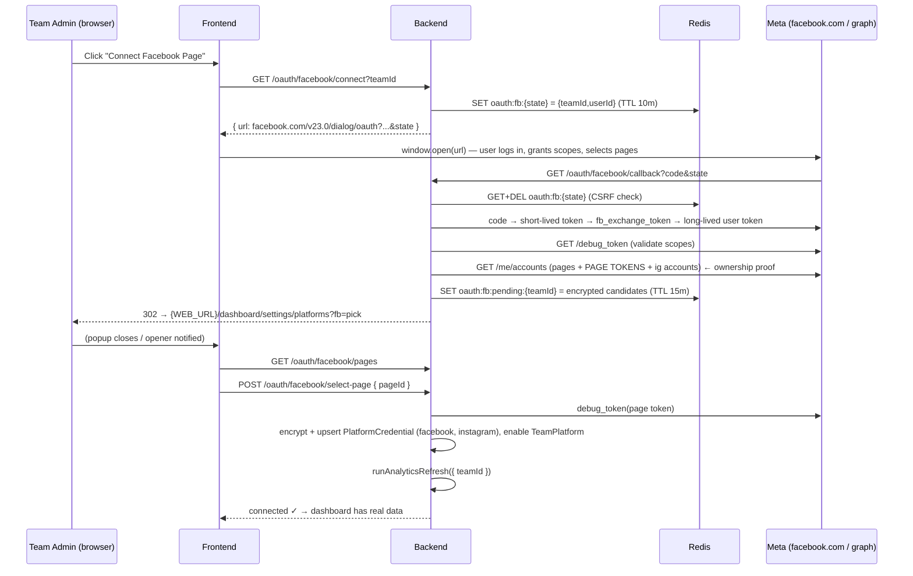
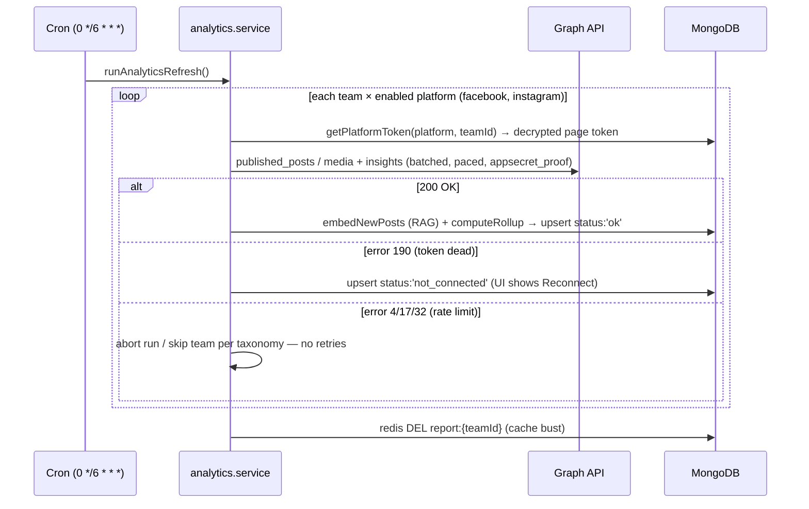

# Facebook + Instagram Real-Data Analytics — Implementation Plan

**Project:** Growth Studio — AI Content & Trend Intelligence Platform
**Date:** 2026-07-16
**Scope decision:** Official OAuth integration (Option A from `SOCIAL-ANALYTICS-FEASIBILITY.md`), **Facebook Pages + Instagram Business only**. YouTube, LinkedIn, X, TikTok stay non-functional (mock / `pending_approval`) until this vertical works end-to-end.

---

## Table of contents

1. [Scope & success criteria](#1-scope--success-criteria)
2. [How Meta's system actually works (mental model)](#2-how-metas-system-actually-works-mental-model)
3. [Meta developer setup — exact steps](#3-meta-developer-setup--exact-steps)
4. [OAuth flow & page-ownership verification](#4-oauth-flow--page-ownership-verification)
5. [Backend implementation](#5-backend-implementation)
6. [Ban-safety & compliance](#6-ban-safety--compliance)
7. [Frontend implementation](#7-frontend-implementation)
8. [Environment & config changes](#8-environment--config-changes)
9. [Phased rollout & testing](#9-phased-rollout--testing)
10. [Sequence diagrams](#10-sequence-diagrams)
11. [Sources](#11-sources)

---

## 1. Scope & success criteria

**In scope**

- A team admin clicks **"Connect Facebook Page"** in Growth Studio, authenticates with Meta, picks one of the Pages they administer, and (if linked) the connected Instagram Business account comes along automatically.
- Our 6-hourly analytics refresh (`ANALYTICS_REFRESH_CRON`, `backend/src/app/lib/scheduler.ts`) pulls **real** post-level and account-level performance metrics for that Page and IG account via the official Graph API.
- The existing rollup pipeline (`analytics.rollup.ts` → `AnalyticsRollup` → `/reports` → RAG embeddings via `embedNewPosts`) runs unchanged on real data.
- The Report dashboard (`frontend/src/pages/dashboard/Report.tsx`, currently a stub) displays it.

**Out of scope (explicitly deferred)**

- YouTube / LinkedIn / X / TikTok real adapters — they keep returning mock or `pending_approval`.
- Publishing/posting to FB/IG (different permissions, different review).
- Ads/paid metrics (Marketing API — separate access tier).

**Success criteria**

1. OAuth connect flow completes and stores an encrypted long-lived Page token + IG user ID against the team.
2. `POST /api/v1/analytics/refresh` produces an `AnalyticsRollup` with `status: 'ok'` and non-zero real metrics for `facebook` (and `instagram` when linked).
3. Token expiry/revocation degrades to `not_connected` with a clear reconnect CTA — never a crash, never silent zeros.
4. Zero non-official API calls; all requests within Meta rate limits (verified via `X-App-Usage` headers).

---

## 2. How Meta's system actually works (mental model)

Getting this model right is what prevents both bugs and bans:

- **One Meta app** (ours, created once) serves all teams. Teams do NOT create Meta apps. Our app has an **App ID** (`FB_CLIENT_ID`) and **App Secret** (`FB_CLIENT_SECRET`).
- **Users, not pages, log in.** A team admin authenticates with their personal Facebook identity. Meta then tells us which Pages that user administers. **That list is the ownership proof** — Meta will never hand us a token for a page the authenticating user doesn't manage. We don't need to (and can't) "verify ownership" any other way.
- **Token chain:** short-lived user token (hours) → long-lived user token (~60 days) → **long-lived Page access token** (does not expire on a timer; dies only if the user changes their password, revokes the app, loses the Page role, or Meta invalidates it).
- **Instagram rides on the Page.** An IG Business/Creator account is linked to a FB Page; `GET /{page-id}?fields=instagram_business_account` returns its `ig_user_id`, and the **same Page token** authorizes IG insights calls. No separate IG login.
- **Development Mode vs Live Mode:** every Meta app starts in Development Mode. In Dev Mode, all permissions work **without App Review** — but only for users who hold a role on the app (Admin/Developer/Tester). Live Mode + App Review is only needed when *arbitrary external users* must connect. This gives us a real-data demo path with zero review wait.
- **Metric migration (critical, June 15 2026):** Meta removed ~85 impression-family metrics (`post_impressions`, `page_posts_impressions`, organic/paid breakdowns, 3-second video views…). Replacements are the **views family** (`post_media_view`, `page_media_view`) and new unique-views metrics for reach. Any tutorial older than mid-2026 will list dead metric names — the current `adapters/facebook.ts` does exactly this and would 400/return-nulls in production. Always verify against [the current Page Insights reference](https://developers.facebook.com/docs/graph-api/reference/insights/) before coding.

---

## 3. Meta developer setup — exact steps

### 3.1 Create the app (one-time, ~15 minutes)

1. Go to [developers.facebook.com](https://developers.facebook.com) → log in with the Facebook account that will own the app (use a team-shared account or the org owner's — app ownership can be moved into a Meta Business Portfolio later).
2. **My Apps → Create App**.
3. Use case: choose **"Other"** → app type **"Business"**. (Business type is what exposes Pages + Instagram Graph API products.)
4. Name: `Growth Studio` (name shown on the consent screen), contact email, create.
5. From the app dashboard, **Add Product → Facebook Login for Business** → choose **Web**.

### 3.2 Configure Facebook Login for Business

Under **Facebook Login for Business → Settings**:

| Setting | Value (dev) | Value (prod) |
|---|---|---|
| Client OAuth Login | ON | ON |
| Web OAuth Login | ON | ON |
| Enforce HTTPS | ON (localhost is exempt) | ON |
| **Valid OAuth Redirect URIs** | `http://localhost:5000/api/v1/oauth/facebook/callback` | `https://api.yourdomain.com/api/v1/oauth/facebook/callback` |
| Login with the JavaScript SDK | OFF (we use server-side redirect flow) | OFF |

> The redirect URI must match **exactly** (scheme, host, port, path) what the backend sends in the `redirect_uri` param, or Meta returns `error=redirect_uri_mismatch`. Our backend already has `OAUTH_REDIRECT_BASE_URL` in `config/index.ts:51` — set it to `http://localhost:5000/api/v1` in dev.

### 3.3 App settings → Basic

- **App Domains:** `localhost` (dev) / your prod domain.
- **Privacy Policy URL:** required before the app can go Live and before App Review; also shown on the consent screen. Host a real page (even a simple one on the frontend at `/privacy`).
- **Data Deletion:** either a **Data Deletion Callback URL** or a **Data Deletion Instructions URL** is required for Live Mode. Plan: implement `POST /api/v1/oauth/facebook/data-deletion` (signed-request parsing, deletes the team's stored credential; see §5.6).
- Note the **App ID** and **App Secret** → `.env` `FB_CLIENT_ID` / `FB_CLIENT_SECRET`.

### 3.4 Permissions we request

| Permission | Why we need it | Dev mode | Prod (App Review) |
|---|---|---|---|
| `public_profile` | Basic identity of authenticating user | auto | auto |
| `pages_show_list` | List Pages the user admins (`/me/accounts`) — the ownership proof | ✅ works for role-holders | Review required |
| `pages_read_engagement` | Read Page posts, comments/reactions summaries | ✅ | Review required |
| `read_insights` | Page + post insights (views, reach) | ✅ | Review required |
| `instagram_basic` | IG account profile + media list | ✅ | Review required |
| `instagram_manage_insights` | IG media + account insights | ✅ | Review required |
| `business_management` | **Only if** a Page is owned via Business Manager and doesn't appear in `/me/accounts` without it. Leave out initially — every extra permission increases review scope | ⚠️ add only if needed | Review required |

**Principle of least privilege:** request exactly these; nothing for publishing (`pages_manage_posts` etc.). Fewer scopes = easier review + smaller blast radius + lower policy risk.

### 3.5 Development Mode strategy (the demo path)

- Keep the app in **Development Mode**.
- **App Dashboard → App Roles → Roles:** add each teammate's Facebook account as **Developer** or **Tester** (they must accept the invite at developers.facebook.com → My Apps → Invitations).
- Any role-holder can now complete the full OAuth flow **with all permissions granted, today, with real data** — for Pages they administer.
- Create a real test Page ("Growth Studio Demo") + link a real IG Professional account to it, post a handful of posts/reels, and the demo runs on genuine Graph API data.
- Optionally use **App Dashboard → Roles → Test Users** for synthetic accounts, but test users can't own IG accounts — a real page you control is better.

### 3.6 User-side prerequisites (document these in the frontend UI)

For a team to connect successfully, the connecting person must:

1. Have a **Facebook account with an Admin (or "Full control") role on the target Page** — Editor/Moderator roles can't grant `read_insights`-bearing page tokens reliably; require full control.
2. (For IG metrics) The Instagram account must be **Professional (Business or Creator)** — Settings → Account type → Switch to professional account — and **linked to that Facebook Page** (IG Settings → Business tools → Connect a Facebook Page, or Page Settings → Linked accounts).
3. In Dev Mode: hold a role on our Meta app (see 3.5). In production (post-review): nothing extra.

### 3.7 App Review (production only — start the clock early)

Needed only when users outside our app roles must connect. Checklist:

- [ ] **Business verification** in Meta Business Manager (legal name, address, docs — days to weeks).
- [ ] Privacy policy URL live; data deletion endpoint live.
- [ ] For each permission: a **screencast** showing the exact user flow in our real UI (login → consent → page pick → dashboard rendering the data), plus written test instructions and a test account Meta reviewers can use.
- [ ] Justification text per permission: "Growth Studio displays a team's own Page/IG performance analytics to inform their content strategy" — usage must match exactly what the screencast shows.
- [ ] Expect 1–3 rounds, ~4–6 weeks total. Rejections are usually: screencast doesn't demonstrate the permission, or the permission isn't visibly necessary.

### 3.8 Costs & access restrictions — everything here is free

**No payment, no page boosting, no time-limited grant is involved anywhere in this plan.**

| Item | Cost | Notes |
|---|---|---|
| Meta developer account + app (App ID/Secret) | Free | |
| All Graph API calls (Page insights, IG insights, OAuth) | Free | Meta's APIs have rate limits, not price tiers — no metering, no billing |
| Development Mode | Free, **indefinite** | No expiry; the app can stay in Dev Mode forever and role-holders pull real data the whole time |
| App Review + Business Verification | Free | Verification needs legal documents, not money; the cost is time (~4–6 weeks) |
| Instagram Business/Creator conversion | Free | |
| Page boosting / ads | **Not needed at all** | Boosting buys ad reach — zero connection to API access. (Only the Marketing API involves money, and even that is ad spend, not API fees — out of scope here) |

**The restrictions that DO exist are compliance-based, not payment-based:**

1. **Dev Mode user cap** — only people with roles on the app (Admin/Developer/Tester) can complete OAuth. A people limit, not a time limit; fine until external customers need to connect (that's what App Review unlocks).
2. **Data Use Checkup** — an annual free questionnaire ("confirm you use each permission as stated"). Skipping it can suspend API access — set a yearly reminder once the app is live.
3. **Unused-permission cleanup** — Meta may revoke Advanced Access permissions an app hasn't called in ~90 days. Doesn't affect us while the 6-hourly refresh cron is running.
4. **Rate limits** scale with active user count (~200 calls/user/hour) — our usage is a rounding error against that (see §6 budget).

Bottom line: create the app today, spend nothing, no clock starts ticking. The only gate between us and *external* users is App Review — which costs time, not money.

---

## 4. OAuth flow & page-ownership verification

### 4.1 The flow (server-side Authorization Code — no JS SDK)

Graph API version: pin **`v23.0`** (current as of mid-2026) in one constant; never call unversioned endpoints.

**Step 1 — Backend builds the login URL** (`GET /api/v1/oauth/facebook/connect?teamId=...`, authenticated, team-admin only):

```
https://www.facebook.com/v23.0/dialog/oauth
  ?client_id={FB_CLIENT_ID}
  &redirect_uri={OAUTH_REDIRECT_BASE_URL}/oauth/facebook/callback
  &state={random 32-byte hex, stored in Redis as oauth:fb:{state} → {teamId, userId}, TTL 10 min}
  &scope=public_profile,pages_show_list,pages_read_engagement,read_insights,instagram_basic,instagram_manage_insights
  &response_type=code
```

Return `{ url }` to the frontend (frontend opens it in a popup or full redirect). The `state` value is our CSRF defense **and** carries the team context through the round-trip without trusting the client.

**Step 2 — User consents on facebook.com** (sees app name, requested permissions, and *chooses which Pages to share* — Meta's own page-selector is part of the consent screen).

**Step 3 — Callback** (`GET /api/v1/oauth/facebook/callback?code=...&state=...`, **unauthenticated route** — the browser arrives from facebook.com without our JWT):

1. Look up `oauth:fb:{state}` in Redis → 404/expired ⇒ reject (CSRF or stale). Delete the key (single-use).
2. Exchange code for **short-lived user token**:
   ```
   GET https://graph.facebook.com/v23.0/oauth/access_token
     ?client_id={FB_CLIENT_ID}&client_secret={FB_CLIENT_SECRET}
     &redirect_uri={same exact redirect_uri}&code={code}
   ```
3. Exchange for **long-lived user token** (~60 days):
   ```
   GET https://graph.facebook.com/v23.0/oauth/access_token
     ?grant_type=fb_exchange_token&client_id=...&client_secret=...
     &fb_exchange_token={short_lived_token}
   ```
4. **Validate what we actually got** with `debug_token` (belt-and-braces — users can decline individual permissions on the consent screen):
   ```
   GET https://graph.facebook.com/v23.0/debug_token
     ?input_token={long_lived_user_token}&access_token={FB_CLIENT_ID}|{FB_CLIENT_SECRET}
   ```
   Check `is_valid`, `scopes` ⊇ required set, `expires_at`. Missing scopes ⇒ redirect to frontend with `?error=missing_permissions&missing=read_insights,...`.
5. **Ownership proof — list administered Pages:**
   ```
   GET https://graph.facebook.com/v23.0/me/accounts
     ?fields=id,name,picture,access_token,instagram_business_account{id,username}
     &access_token={long_lived_user_token}
   ```
   - Returns **only** Pages where this user has a role, with a **Page access token** per page. Because the user token was long-lived, these page tokens are **long-lived page tokens (no scheduled expiry)**.
   - Empty list ⇒ the user admins no Pages (or granted no pages on the consent screen) ⇒ redirect with `?error=no_pages`.
6. Store the candidate list (page id/name/picture/ig account, encrypted page tokens) in Redis `oauth:fb:pending:{teamId}` (TTL 15 min) — the user picks a page in the next step. Do **not** persist all tokens permanently; persist only the chosen page's.
7. Redirect browser to `{WEB_URL}/dashboard/settings/platforms?fb=pick` (frontend then calls Step 4).

**Step 4 — Page selection** (`GET /api/v1/oauth/facebook/pages` lists the pending candidates without tokens; `POST /api/v1/oauth/facebook/select-page { pageId }`, authenticated, team-admin):

1. Pull pending list from Redis; find the chosen page.
2. `debug_token` the **page token** too (confirm `type: PAGE`, `profile_id == pageId`).
3. Persist via the existing credential machinery (§5.2): one `PlatformCredential` row for `facebook`, and if `instagram_business_account` exists, a second row for `instagram` **with the same encrypted page token** and the `ig_user_id` in `account_id`.
4. Ensure `TeamPlatform` rows (`facebook`, `instagram`) are enabled (reuse `PlatformCatalogService`).
5. Delete the Redis pending key. Trigger an immediate one-team refresh (`runAnalyticsRefresh({ teamId })`) so the dashboard has data within seconds, not 6 hours.

**Disconnect** (`DELETE /api/v1/oauth/facebook`, team-admin): call `DELETE https://graph.facebook.com/v23.0/{pageId}/permissions?access_token={page_token}` **and** `DELETE /me/permissions` with the user token if still stored (revokes the grant on Meta's side — required by policy when a user disconnects), then delete both `PlatformCredential` rows and upsert `not_connected` rollups.

### 4.2 Why this constitutes ownership verification

- The Page token is minted by Meta **only** through `/me/accounts` of an authenticated admin — there is no code path where a non-admin obtains it.
- We additionally `debug_token` every token we store and record `profile_id`, granted `scopes`, and `expires_at`.
- Tokens are stored AES-256-GCM encrypted (existing `backend/src/app/lib/crypto.ts`), `select: false` in the schema, revealed only via the existing audited `reveal` endpoint.

### 4.3 Token lifecycle

| Token | Lifetime | Renewal |
|---|---|---|
| Short-lived user | ~1–2 h | n/a (used once in callback) |
| Long-lived user | ~60 days | Not stored long-term (optional: keep to re-mint page tokens without re-login) |
| **Long-lived Page (what we store)** | No scheduled expiry | Dies on: password change, user revokes app, user loses Page role, Meta security invalidation ⇒ Graph returns **error code 190** ⇒ we mark `not_connected`, frontend shows "Reconnect Facebook" |

There is no silent refresh for a dead page token — reconnection requires the user to redo the (30-second) OAuth flow. Handle it as a first-class UI state, not an error.

---

## 5. Backend implementation

### 5.1 New module: `backend/src/app/modules/MetaOAuth/`

Follow the existing module pattern (route/controller/service/validation, `catchAsync`, `sendResponse`):

```
MetaOAuth/
├── metaOAuth.route.ts        # mounts under /oauth/facebook
├── metaOAuth.controller.ts
├── metaOAuth.service.ts      # all Graph calls for the OAuth dance
├── metaOAuth.validation.ts   # zod for select-page body, callback query
└── metaOAuth.graph.ts        # tiny typed fetch wrapper: graphGet(path, params, token)
                              #   - pins v23.0, appsecret_proof, error envelope parsing,
                              #   - reads X-App-Usage header and logs at >75%
```

Routes (register `{ path: '/oauth/facebook', route: MetaOAuthRoutes }` in `app/routes/index.ts`):

| Method & path | Auth | Purpose |
|---|---|---|
| `GET /oauth/facebook/connect?teamId=` | `requireAuth` + `requireTeamAccess` (admin) | Returns `{ url }` |
| `GET /oauth/facebook/callback` | **none** (state-validated) | Code exchange → pending list → redirect to frontend |
| `GET /oauth/facebook/pages?teamId=` | `requireAuth` + team admin | Pending page candidates (no tokens in payload) |
| `POST /oauth/facebook/select-page` | `requireAuth` + team admin | Persist chosen page + IG, enable platforms, kick refresh |
| `DELETE /oauth/facebook?teamId=` | `requireAuth` + team admin | Revoke + delete credentials |
| `POST /oauth/facebook/data-deletion` | signed-request | Meta data-deletion callback (§5.6) |

**`appsecret_proof`:** send `appsecret_proof=HMAC-SHA256(access_token, app_secret)` on every server-side Graph call and enable **App Dashboard → Settings → Advanced → Require App Secret**. This makes stolen tokens useless outside our server — major safety win, trivial to implement in `metaOAuth.graph.ts`.

### 5.2 `PlatformCredential` schema extension (additive, non-breaking)

`platformCredential.model.ts` gains optional fields:

```ts
token_type:       { type: String, enum: ['page', 'user', 'api_key'], default: 'api_key' },
token_expires_at: { type: Date },            // null = no scheduled expiry (page tokens)
scopes:           [{ type: String }],        // granted scopes from debug_token
page_id:          { type: String },          // FB page id (also on the instagram row)
external_name:    { type: String },          // page name / ig username for UI display
connected_by:     { type: String },          // user id who ran the OAuth flow
```

`account_id` (already exists) holds: FB row → page id; IG row → `ig_user_id`. Existing rows are untouched (all new fields optional). `getPlatformToken()` (`lib/platformCredentials.ts`) needs **no change** — it already returns the decrypted token per team+platform.

### 5.3 Rewrite `adapters/facebook.ts` (current one is broken — see feasibility report)

```ts
// Page posts of last 30 days, with REAL engagement + post-June-2026 insight metrics
GET /v23.0/{page_id}/published_posts
  ?fields=id,message,created_time,attachments{media_type},
          reactions.summary(true).limit(0),comments.summary(true).limit(0),shares,
          insights.metric(post_media_view,post_media_view_unique)
  &since={unix_30d_ago}&limit=25
  &access_token={page_token}
```

Mapping to `IAdapterPost.metrics`:

| Our field | Graph source | Note |
|---|---|---|
| `views` | `post_media_view` | Views family replaced `post_impressions` (June 15 2026) |
| `reach` | `post_media_view_unique` | Unique-views metric replaced `post_impressions_unique` |
| `likes` | `reactions.summary.total_count` | All reaction types |
| `comments` | `comments.summary.total_count` | |
| `shares` | `shares.count ?? 0` | Absent when 0 |
| `format` | `attachments.media_type` → `photo/video/link/status` | Feeds `content_breakdown` |

> ⚠️ **Verify metric names in Graph API Explorer before coding** (Phase 1 step). Meta's June-2026 migration is recent; if `post_media_view` isn't yet available on some page, fall back gracefully: request insights in a **second call per batch** and tolerate `(#100) metric not supported` by zeroing views/reach rather than failing the post list. Never let insights failure kill engagement data.

Pagination: follow `paging.next` up to 4 pages (100 posts max) — matches the 30-day window and keeps call volume tiny.

The signature changes from `(token: string)` to `(token: string, accountId: string)` — `adapters/index.ts` passes `credential.account_id` through (small refactor of `AdapterFn`; the service already loads the credential).

### 5.4 New `adapters/instagram.ts`

```ts
// 1. Media list (last 30 days)
GET /v23.0/{ig_user_id}/media
  ?fields=id,caption,media_type,media_product_type,timestamp,
          like_count,comments_count
  &since={unix_30d_ago}&limit=25&access_token={page_token}

// 2. Insights per media (batched, §6.2): metric set depends on media_product_type
//    FEED/CAROUSEL: views,reach,saved,total_interactions
//    REELS:         views,reach,saved,shares,total_interactions
GET /v23.0/{media_id}/insights?metric=views,reach,saved&access_token={page_token}
```

Mapping: `views→views`, `reach→reach`, `like_count→likes`, `comments_count→comments`, `shares` (reels) → `shares`; `format` from `media_product_type` (`FEED`→post, `REELS`→reel, `STORY`→story). IG stories vanish after 24h — skip `STORY` items.

(IG also replaced `impressions` with `views` across media insights in 2025-26 — same "views family" rule as FB.)

### 5.5 Selective real adapters (FB/IG real, everything else mock)

Replace the single boolean with an allowlist while keeping backward compatibility:

```
# .env — replaces ANALYTICS_USE_MOCK_ADAPTERS=false for our purpose
ANALYTICS_REAL_PLATFORMS=facebook,instagram
```

`adapters/index.ts`:

```ts
export const getAdapter = (platform: string): AdapterFn => {
  const real = REAL_ADAPTERS[platform];
  const realEnabled = config.analytics.real_platforms.includes(platform);
  if (real && realEnabled) return (token, teamId, plat, accountId) => real(token, accountId);
  return (_t, teamId, plat) => mockAdapter(teamId, plat);
};
```

`ANALYTICS_USE_MOCK_ADAPTERS=true` (default) still forces all-mock (test suites unaffected); when it's `false`, only platforms in `ANALYTICS_REAL_PLATFORMS` go real. `instagram` gets registered in `REAL_ADAPTERS`; `youtube`/`linkedin` get **removed** from it (explicitly non-functional per this scope — their broken/stub adapters stop being reachable).

### 5.6 Error handling, token death & the data-deletion callback

In `analytics.service.ts` `runAnalyticsRefresh`, catch Graph errors by code (the Graph error envelope is `{ error: { code, error_subcode, message, type } }` — parse it in `metaOAuth.graph.ts` and throw a typed `GraphApiError`):

| Graph code | Meaning | Our action |
|---|---|---|
| 190 (any subcode) | Token expired/revoked/invalid | Upsert rollup `status: 'not_connected'`, set `token_expires_at: now` on the credential (flag for UI), **do not retry** |
| 10, 200–299 | Permission missing/revoked | `not_connected` + log which permission |
| 4 | App-level rate limit | Abort the whole refresh run, log, let next cron retry |
| 17, 32 | User/Page-level rate limit | Skip this team+platform this run, `status: 'error'`, continue others |
| 1, 2 | Transient Meta error | One retry with 5s delay, then `status: 'error'` |
| `(#100) metric not supported` | Metric name drift | Zero that metric, keep the rest, log loudly |

**Data-deletion callback** (required for Live Mode): `POST /oauth/facebook/data-deletion` receives `signed_request` (HMAC-SHA256 with app secret, base64url payload containing `user_id`). Verify signature → delete all `PlatformCredential` rows where `connected_by` maps to that Meta user → respond `{ url: "<status page>", confirmation_code: "<id>" }`.

### 5.7 Testing (mirror existing `__tests__` patterns)

- `metaOAuth.integration.test.ts`: mock `fetch` for Graph endpoints (same style as `support/openrouterMock.ts`); test state validation (bad/expired/reused state ⇒ 4xx), scope-missing redirect, page selection persisting encrypted rows, disconnect revoking.
- `analytics.facebook.adapter.test.ts`: fixture Graph responses (incl. a 190 error, a metric-not-supported partial) → assert `IAdapterPost` mapping and error taxonomy.
- Existing suites keep passing because `NODE_ENV=test` keeps `ANALYTICS_USE_MOCK_ADAPTERS=true`.

---

## 6. Ban-safety & compliance

**What actually gets apps/pages restricted — and our countermeasure for each:**

| Ban vector | Do we do it? | Countermeasure |
|---|---|---|
| Scraping / unofficial endpoints / logged-in automation | **Never** | Only versioned `graph.facebook.com` endpoints with OAuth tokens |
| Reading data of accounts that didn't consent | **Never** | Page tokens only exist for admin-consented pages; we request read-only scopes |
| Excessive call volume | Structurally impossible at our cadence | See budget below |
| Permission misuse (using data beyond stated purpose) | No | Data used solely to render the team's own dashboard + their private RAG; matches review justification |
| Storing/leaking tokens | Mitigated | AES-256-GCM at rest, `select:false`, `appsecret_proof` + "Require App Secret" makes exfiltrated tokens unusable |
| Spammy posting / automation of user actions | Not in scope | No publish permissions requested at all |

**Rate-limit budget (why we're 3+ orders of magnitude under the ceiling):**

- Platform limit ≈ `200 calls × active users / hour` per app rolling window; page-token calls fall under Business Use Case limits with similar headroom.
- Our refresh, per team per 6 hours: 1 `published_posts` call (+ ≤3 pagination) + 1 IG media call + ~25 IG insights calls (batched → ~2 batch calls) ≈ **≤10 calls/team/6h ≈ 1.7 calls/team/hour**. Even 100 teams ≈ 170 calls/hour app-wide.
- Discipline anyway:
  1. Reuse the existing 100 ms inter-call pacing pattern (`analytics.service.ts` embedNewPosts loop) between Graph calls.
  2. Use **batch requests** (`POST /` with `batch=[...]`, ≤50 sub-requests) for per-media IG insights — 25 media = 1 HTTP call.
  3. Parse `X-App-Usage` / `X-Business-Use-Case-Usage` response headers in `metaOAuth.graph.ts`; at >75% utilization log a warning, at >90% abort the run (code-4 handling path).
  4. Never tight-loop retries; error taxonomy above ensures at most one retry per call.
  5. `since` + `fields` filtering on every call — never fetch unfiltered feeds.

**Data policy hygiene:**

- Store only what the dashboard needs (metrics, snippets ≤200 chars, ids). No follower PII, no comment authors.
- Deletion: disconnect endpoint + data-deletion callback both purge credentials; add team deletion cascade (already deletes per-team data).
- Privacy policy page states: what we fetch (page/IG performance metrics), why (team's own analytics), retention (until disconnect), no third-party sharing.
- Respect versioning: pin `v23.0`, subscribe to the [Platform changelog](https://developers.facebook.com/docs/graph-api/changelog) — each version lives ~2 years.

---

## 7. Frontend implementation

### 7.1 Platform connection UI (settings)

New page/section `frontend/src/pages/dashboard/settings/Platforms.tsx` (wire into the existing role-based routes in `src/routes/`):

- Card per platform. Facebook card states:
  - **Not connected:** violet CTA "Connect Facebook Page" + prerequisite checklist (Page admin, IG linked — from §3.6). On click: `apiGet('/oauth/facebook/connect?teamId=…')` → `window.open(url, 'fb-oauth', 'width=600,height=750')`.
  - **Picking:** after the popup redirects to `/dashboard/settings/platforms?fb=pick`, the opener (poll `window.closed` or `postMessage`) fetches `GET /oauth/facebook/pages` → modal listing pages (name + avatar + "IG linked" badge) → `POST /oauth/facebook/select-page`.
  - **Connected:** page name/avatar, IG username badge, "connected by {user} on {date}", Disconnect button (confirm dialog → `DELETE /oauth/facebook`).
  - **Needs reconnect:** when rollup `status === 'not_connected'` but a credential exists (token died) — amber banner "Facebook connection expired — reconnect".
- Other platforms (YouTube/LinkedIn/X/TikTok): render with a "Coming soon" disabled state — honest non-functional.

### 7.2 Report dashboard (`pages/dashboard/Report.tsx` — currently "Coming soon")

Data: react-query (`lib/queryClient.ts` exists) over existing endpoints — `GET /analytics?teamId=` (rollups per platform) and `GET /reports?teamId=` (LLM narrative). Components under `src/components/report/` per CLAUDE.md conventions:

- **Platform tabs** (Facebook / Instagram) driven by which rollups exist.
- **Overview stat cards:** Reach, Views, Engagements, Engagement Rate (`overview` object) — `glass-card` + `gradient-text`, amber/emerald accents per design tokens.
- **Top posts table:** `top_posts` (snippet, format chip, reach, engagement), mobile-first collapse to cards at <640px.
- **Best times heatmap:** `best_times` (day × hour grid, violet intensity).
- **Format breakdown:** `content_breakdown` bar list.
- **Status states:** `not_connected` → CTA linking to settings; `pending_approval` → info banner; `error` → retry hint + `fetched_at` timestamp; loading skeletons.
- "Demo data" badge when the backend serves mock (expose `is_mock` on the rollup response — one-line backend addition).

### 7.3 API client additions (`lib/api/`)

`lib/api/meta.ts`: `getFacebookConnectUrl(teamId)`, `listPendingPages(teamId)`, `selectPage(teamId, pageId)`, `disconnectFacebook(teamId)`; `lib/api/analytics.ts`: `getAnalytics(teamId)`, `getReport(teamId)` — all through the existing `apiGet/apiPost/apiDelete` helpers (auth + refresh handled by the interceptor already).

---

## 8. Environment & config changes

```bash
# backend/.env additions
FB_CLIENT_ID=<from app dashboard>          # key already exists in config schema
FB_CLIENT_SECRET=<from app dashboard>      # key already exists in config schema
OAUTH_REDIRECT_BASE_URL=http://localhost:5000/api/v1   # already exists; confirm value
ANALYTICS_USE_MOCK_ADAPTERS=false          # flip when going real
ANALYTICS_REAL_PLATFORMS=facebook,instagram # NEW
GRAPH_API_VERSION=v23.0                     # NEW (single upgrade point)
```

- `config/index.ts`: add `ANALYTICS_REAL_PLATFORMS` (default `''`) parsed to array under `config.analytics.real_platforms`, and `GRAPH_API_VERSION` (default `v23.0`). Remove nothing — `FB_PAGE_TOKEN`/`FB_PAGE_ID` bootstrap keys stay but are unused by the new flow.
- **Docker note:** the callback URL is opened by the *user's browser*, not container-to-container — `http://localhost:5000/...` works fine with the existing port mapping in `docker-compose.yml`. No compose changes required. For a deployed demo, the backend must be on HTTPS (Meta enforces HTTPS for non-localhost redirect URIs).
- Production: different Meta app **or** the same app with the prod redirect URI added to the whitelist; secrets via deployment env, never committed.

---

## 9. Phased rollout & testing

### Phase 1 — Meta app + manual token proof (½ day, no code)

1. Create app per §3, add teammates as Testers, set redirect URI.
2. In **Graph API Explorer** (developers.facebook.com/tools/explorer): select our app → get user token with our 6 scopes → `GET /me/accounts` → grab the page token.
3. Manually verify the exact adapter queries from §5.3/§5.4 against the demo page — **this is where metric names (`post_media_view` etc.) get confirmed or corrected** before any code depends on them.
4. ✅ Exit criteria: raw JSON with real views/reach/reactions in hand.

### Phase 2 — Backend OAuth module + adapters (2–3 days)

1. Build `MetaOAuth` module, schema extension, `metaOAuth.graph.ts`, both adapters, selective-real config.
2. Verify locally: run the connect flow from the browser against `localhost:5000` (backend in Docker as fixed earlier), pick the demo page, then `POST /api/v1/analytics/refresh` (super-admin JWT) and check the `analytics_rollups` collection for `status: 'ok'` + real numbers.
3. Kill-switch test: revoke the app from the Facebook account (facebook.com → Settings → Apps) → next refresh must yield `not_connected`, no crash.
4. Integration tests per §5.7 green; `npm run build` clean.

### Phase 3 — Frontend (2 days)

1. Settings platform card + popup flow + page picker; Report dashboard components.
2. E2E happy path: fresh team → connect → pick page → dashboard shows real data (immediate refresh from §4.1 step 4.5). Test at 375px width and dark mode per project rules.
3. Edge states rendered: no pages, missing scopes, expired token, mock platforms.

### Phase 4 — Production readiness (parallel, weeks)

1. Business verification + privacy policy + data-deletion endpoint live.
2. App Review submission with screencasts (§3.7). Stay in Dev Mode for the demo regardless — review is only for external users.

---

## 10. Sequence diagrams

### Connect flow



### 6-hourly refresh



---

## 11. Sources

- [Meta — Get long-lived access tokens](https://developers.facebook.com/docs/facebook-login/guides/access-tokens/get-long-lived/) (user → long-lived → non-expiring page tokens via `/me/accounts`)
- [Meta — Page Insights reference](https://developers.facebook.com/docs/graph-api/reference/insights/) · [Meta — Permissions reference](https://developers.facebook.com/docs/permissions/)
- [Meta — Instagram Platform insights](https://developers.facebook.com/docs/instagram-platform/insights/) · [IG media insights reference](https://developers.facebook.com/docs/instagram-platform/reference/instagram-media/insights/)
- [Meta — Graph API rate limiting](https://developers.facebook.com/docs/graph-api/overview/rate-limiting/) · [Graph API changelog](https://developers.facebook.com/docs/graph-api/changelog)
- June-2026 metric migration coverage: [Supermetrics — Facebook Insights field changes June 2026](https://docs.supermetrics.com/docs/facebook-insights-field-changes-june-30-2026-1) · [Emplifi — Facebook metric deprecation June 2026](https://docs.emplifi.io/platform/latest/home/facebook-metric-deprecation-june-2026) · [Sprinklr — Meta impressions deprecation impact](https://www.sprinklr.com/help/articles/overview/meta-impressions-metric-deprecation-in-social-analytics-impact-on-unified-analytics/6901efa8b9d0c1065ebc0ffb)
- [Elfsight — Instagram Graph API developer guide 2026](https://elfsight.com/blog/instagram-graph-api-complete-developer-guide-for-2026/) · [Zernio — Instagram API options 2026](https://zernio.com/blog/instagram-api)
