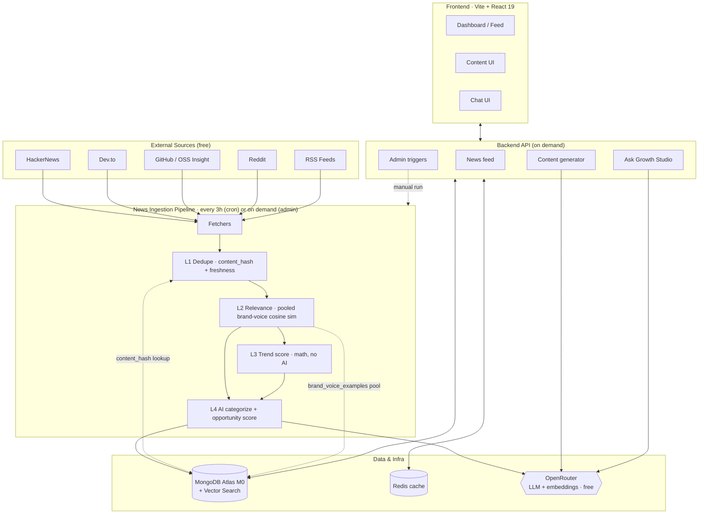
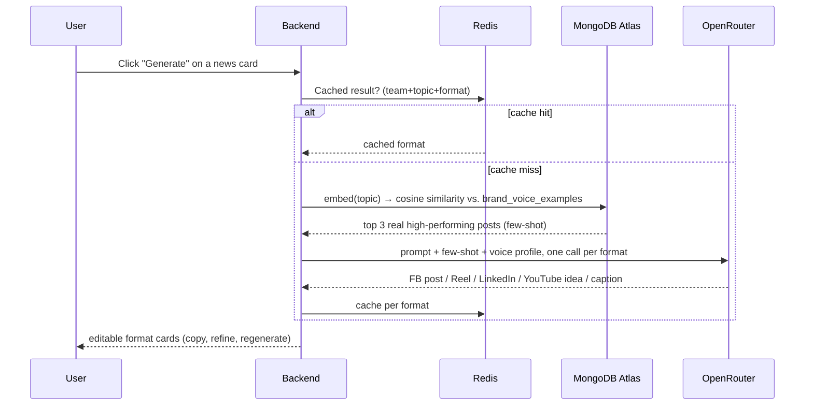

# Growth Studio

> **AI Content & Trend Intelligence Platform** — spots what's trending in tech and turns it into a full week of content for Facebook, YouTube, and LinkedIn in 5 minutes, in your own brand voice. Zero AI cost, zero API cost.

**Team Next Wave** · Hackathon topic: *AI Content & Trend Recommendation* · Jul 12–18, 2026

---

## Table of Contents

- [The Problem](#the-problem)
- [The Solution](#the-solution)
- [System Architecture](#system-architecture)
- [Subsystems](#subsystems)
- [Key Data Flows](#key-data-flows)
- [Data Model](#data-model)
- [Tech Stack](#tech-stack)
- [Repository Layout](#repository-layout)
- [Getting Started](#getting-started)
- [Requirements Traceability](#requirements-traceability)
- [Out of Scope](#out-of-scope-phase-2)
- [Team](#team)

---

## The Problem

The Programming Hero marketing team creates content for **Facebook, YouTube, and LinkedIn** at once, and hits three compounding problems:

1. **No visibility into trends** — hours wasted manually browsing HackerNews, Dev.to, Twitter.
2. **Slow, inconsistent content creation** — every platform needs a different tone; they can't keep up.
3. **Content doesn't sound like them** — generic AI output reads nothing like a real Bangladeshi tech writer.

## The Solution

Growth Studio is a content-intelligence platform that does three things:

| # | Capability | What it does |
|---|-----------|--------------|
| 1 | **Monitor** | Pulls tech trends 24/7 from HackerNews, Dev.to, GitHub, Reddit, RSS |
| 2 | **Rank** | Scores content ideas by trend momentum and category fit |
| 3 | **Generate** | One click → FB post, Reel script, LinkedIn post, YouTube idea, caption — in your brand voice, grounded in your team's own real posts |

---

## System Architecture

Growth Studio is a **monorepo** with two logical planes: an unattended background pipeline that keeps trend data fresh, and an on-demand serving layer that powers the dashboard.



**Design principle running through everything:** *AI is used only where it adds value.* Cheap hash-based dedup and pure-math trend scoring gate the expensive LLM calls, keeping ingestion cost near **$0** as volume scales — the LLM only runs on items that survive dedup + relevance.

> **Built differently than originally planned (2026-07-14):** the ingestion pipeline that shipped uses exact `content_hash` dedup (not vector similarity) and has no Redis-cache layer or keyword pre-filter — see [`project-ida-requirments.md`](./project-ida-requirments.md)'s FR-02/FR-04 notes and `SAMIN.md` for the full deviation writeup. Redis is still used elsewhere (generation caching), just not in this pipeline.

---

## Subsystems

### 1. News Ingestion Pipeline (every 3h via cron, or on demand via admin trigger)
Fetches from 5 free sources (HackerNews, Dev.to, GitHub Trending, Reddit, RSS — each isolated so one failing source never kills the run), then runs a **4-layer pipeline**:

| Layer | Check | Cost |
|------|-------|------|
| **L1 — Dedupe + freshness** | Exact-match `content_hash` (SHA-256 of `source:url`) against MongoDB + already-seen-this-run; drop items older than `NEWS_INGESTION_MAX_AGE_HOURS` (default 72h) | Zero (hash + DB lookup, no embedding) |
| **L2 — Relevance gate** | Embed the item, score = max cosine similarity vs. the **pooled embeddings of every team's `BrandVoiceExample`**; drop if below `NEWS_INGESTION_MIN_RELEVANCE` (default 4.0) — *skipped entirely if no brand voice examples exist yet (cold start)* | Embedding only |
| **L3 — Trend score** | Pure math from source engagement, no AI | Zero |
| **L4 — AI categorize + opportunity score** | Batched LLM call (~10 items/call) assigns category, impact note, confidence (0-1), and audience fit (0-1); falls back to `category: 'Other'` + zero confidence on a malformed response. `opportunity_score` itself is **not** LLM-picked — it's computed deterministically from `relevance_score`, `trend_score`, and the LLM's audience-fit signal (see note below) | LLM (survivors only) |

Trend score is computed by pure math (no AI):

```
trend_score = min(10, log10(points + comments×2 + stars_delta×3 + 1) × 3)
```

> **Deviates from the original plan** (keyword pre-filter → vector dedup → Redis cache → relevance gate): this is exact-hash dedup, not vector/semantic similarity, so two different URLs covering the same story (e.g. the same launch on both HN and Dev.to) are **not** caught as duplicates — that was a deliberate hackathon-timeline scope call, not an oversight. See `SAMIN.md` and [`project-ida-requirments.md`](./project-ida-requirments.md) FR-02/FR-04 for the full write-up.

> **Extended 2026-07-14 (`ai-categorization-scoring`):** `opportunity_score` is no longer picked freely by the LLM — it's now computed in code as `W_RELEVANCE×relevance_score + W_TREND×trend_score + W_FIT×(audience_fit×10)` from a new bounded `audience_fit` (0-1) the LLM supplies alongside `category`, plus a new `confidence` (0-1) that drives a `needs_review` flag on low-confidence items. Teams can also define their own custom categories on top of the fixed default taxonomy and override an item's category/opportunity score for their own view — via a separate `news_item_category_overrides` collection, so the shared `news_items` document itself is never mutated and other teams never see the override. Full write-up in `SAMIN.md`.

### 2. Serving / API Layer (on demand)
- **News feed** — filter by category (fixed defaults + each team's own custom categories), sort by latest/relevance/trend, "High opportunity"/"Needs review" badges, per-team recategorize + opportunity-score override
- **Content generator** — lazy (fires on click), 5 formats, Brand Voice RAG, Redis-cached, per-format refine/regenerate
- **Ask Growth Studio** — natural-language RAG chat grounded in the team's trending news
- **Admin triggers** — manually run an ingestion pass (demo tooling)

### 3. Frontend (Vite + React 19)
daily.dev-style dark dashboard: card feed with tabs, one-click generation, drafts review, chat.

---

## Key Data Flows

**Vector indexes over two MongoDB Atlas collections** (`news_items.embedding`, `brand_voice_examples.embedding` — 1536-dim, cosine):

| Flow | Trigger | Path |
|------|---------|------|
| **Dedup** *(not the vector flow originally planned — built as exact-match instead, see note above)* | Ingestion | `content_hash` (SHA-256 of `source:url`) checked against MongoDB — no embedding, no `$vectorSearch` |
| **Relevance gate** | Ingestion | embed item → cosine similarity vs. pooled `BrandVoiceExample` embeddings (in-memory, not `$vectorSearch`) → max score, or skip filtering entirely if the pool is empty |
| **Ask Growth Studio** | User question | embed query → cosine similarity over trending `news_items` → LLM → grounded answer |
| **Brand Voice RAG** *(built differently — see note below)* | Generate click | embed topic → **in-app cosine similarity** (not `$vectorSearch`) over the *requesting team's own* `brand_voice_examples` → few-shot into a per-format prompt |

> **Built differently than originally planned (2026-07-14):** `brand-voice-rag` (`POST /content/generate`, `backend/src/app/modules/ContentGeneration/`) shipped as a deliberate, confirmed-with-the-user scope cut from the row above and the sequence diagram below — see `SAMIN.md` for the full write-up:
> - Retrieval is **team-scoped, in-app cosine similarity** (mirroring the existing `newsIngestion.scoring.ts` pattern), not an Atlas `$vectorSearch` aggregation — per-team pools are small enough that the extra complexity isn't worth it yet.
> - **Cold start** (a team with zero `brand_voice_examples`) skips all few-shot retrieval and falls back to a generic brand-neutral prompt, rather than borrowing another team's examples.
> - Generated content is cached in Redis per team/topic/language/pack/format, and persisted on explicit save via `generated_content` (drafts, approve/dismiss workflow) — not a one-shot stateless call.
> - Each requested format is its own LLM call (not one shared JSON blob), so format-specific length/structure targets (e.g. LinkedIn 1,200–2,500 chars) are enforceable per call.

Content generation end to end:



---

## Data Model

MongoDB collections (see [`project-ida-requirments.md`](./project-ida-requirments.md) §5.8 for full field lists):

| Collection | Purpose | Vector index |
|-----------|---------|:---:|
| `news_items` | Ingested + enriched news (trend/relevance/impact/confidence/needs_review) — global, not team-scoped | ✅ |
| `news_item_category_overrides` | Per-team override of a `news_items` document's `category`/`opportunity_score` (`news_item_id` + `team_id` unique) — merged into reads for the requesting team only, never mutates the shared item | — |
| `generated_content` | Saved drafts (auto and manual), per-format text, `status: draft/approved/dismissed` | — |
| `brand_voice_examples` | 25–30 real posts seeded as few-shot voice — scoped per team (`team_id`) | ✅ |
| `style_packs` / `style_examples` | Globally shared, super_admin-curated writer styles teams can opt into | ✅ |

**Auth / multi-team collections:**

| Collection | Purpose |
|-----------|---------|
| `users` | Accounts; `role: 'super_admin' \| 'admin' \| 'user'`. No public self-registration — admins/super_admins create every account (`POST /users`), plus a `SUPER_ADMIN_EMAIL`/`SUPER_ADMIN_PASSWORD`-driven bootstrap on server start |
| `teams` | Growth teams (many-to-many membership with `users` via `team_memberships`); `custom_categories: string[]` lets each team extend the fixed default news-category taxonomy; `voice_profile` (language + custom instructions) and `default_style_pack_id` live here too |
| `team_memberships` | Join collection: which users belong to which teams |

---

## Tech Stack

| Layer | Choice | Notes |
|------|--------|------|
| **Frontend** | Vite + React 19, TypeScript, Tailwind CSS v4, React Router v7 | Dark-first, mobile responsive |
| **Backend** | Node.js + TypeScript (in `backend/`) | REST + OpenAPI spec; JWT auth, roles (`user`/`admin`/`super_admin`), multi-team data isolation |
| **Database** | MongoDB Atlas M0 + Atlas Vector Search | Free tier |
| **Cache** | Redis | Dedup keys, content-generation caching |
| **AI** | OpenRouter free tier | LLMs + embeddings |
| **Scheduling** | Cron jobs | News ingestion every 3h, auto-generation daily |

**AI models (all OpenRouter free tier):** see `backend/.env.example` for the current model set (categorization, content generation, chat, fallback, embeddings all configurable per-deployment).

> **Cost targets:** $0 AI + $0 platform API. Feed loads < 1.5s cached, generation < 10s, chat < 6s. See requirements §5 (NFRs).

---

## Repository Layout

```
AI-Content-Trend-Recommendation/
├─ frontend/                    # Vite + React 19 app (landing + dashboard)
│  ├─ src/pages/                # route components
│  └─ src/components/landing/   # landing-page sections
├─ backend/                     # API + ingestion pipeline
├─ openspec/                    # spec-driven change management
│  ├─ changes/<name>/           # one folder per proposed change
│  └─ config.yaml
├─ project-ida-requirments.md   # full product requirements (source of truth)
├─ SPEC-DRIVEN-WORKFLOW.md      # how the 3-dev team works without conflicts
├─ CLAUDE.md                    # AI assistant / contributor conventions
└─ README.md                    # you are here
```

---

## Getting Started

```bash
# Frontend
cd frontend && npm install
npm run dev          # http://localhost:5173
npm run build        # tsc -b && vite build
npm run lint          # eslint

# Backend
cd backend && npm install
npm run dev              # http://localhost:3001, docs at /api/v1/docs
npm run typecheck
npm run lint
npm run seed:admin -- <email> <password> <name> [admin|super_admin]   # bootstrap an account manually
```

Required environment (backend `.env` — copy from `.env.example`, all free tiers): `DATABASE_URL`, `REDIS_URL`, `OPENROUTER_API_KEY`, `JWT_SECRET`. Optional: `SUPER_ADMIN_EMAIL`/`SUPER_ADMIN_PASSWORD` (auto-seeds a super_admin on server start if that account doesn't exist yet).

> **New to the team?** Read [`SPEC-DRIVEN-WORKFLOW.md`](./SPEC-DRIVEN-WORKFLOW.md) before your first commit — it's how we avoid merge conflicts across 3 developers.

---

## Requirements Traceability

Full functional and non-functional requirements live in [`project-ida-requirments.md`](./project-ida-requirments.md) §5. Each OpenSpec change under `openspec/changes/` maps its specs back to these IDs.

## Out of Scope (Phase 2)

Auto-publishing · dedicated vector DB (Pinecone/Weaviate) · Slack/Discord notifications · A/B testing · white-label.

> **Scope update (2026-07-14):** auth & multi-workspace — originally listed here as Phase 2 — was pulled *into* scope and built on the backend, once it became clear the platform needs to serve several real growth teams, not one. See [Data Model](#data-model) above and `backend/src/app/modules/{User,Team}/`. Frontend UI for it (login, admin/super_admin screens, team settings) has since shipped — see `frontend/src/pages/dashboard/settings/Team.tsx`.

---

## Team

**Next Wave** — Web Course Level-02

| Name | Role |
|------|------|
| Samin Israr Ravi | Developer |
| Mehedi Imun | Developer |
| Robayat Kalam Farsit | Developer |

> One-liner for judges: *"Growth Studio spots what's trending in tech and turns it into a full week of content for Facebook, YouTube, and LinkedIn in 5 minutes — in your own brand voice, for free."*
