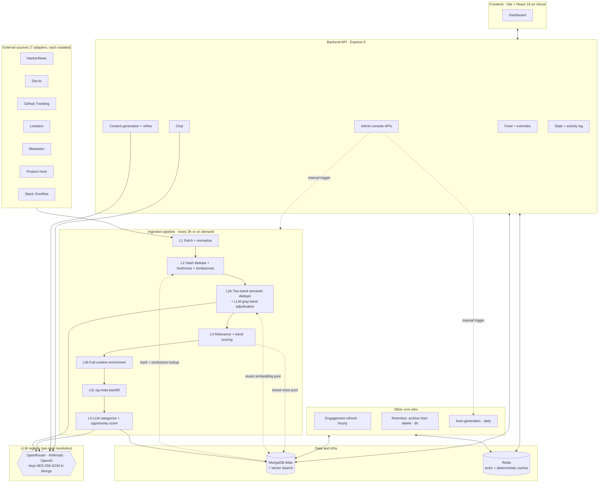
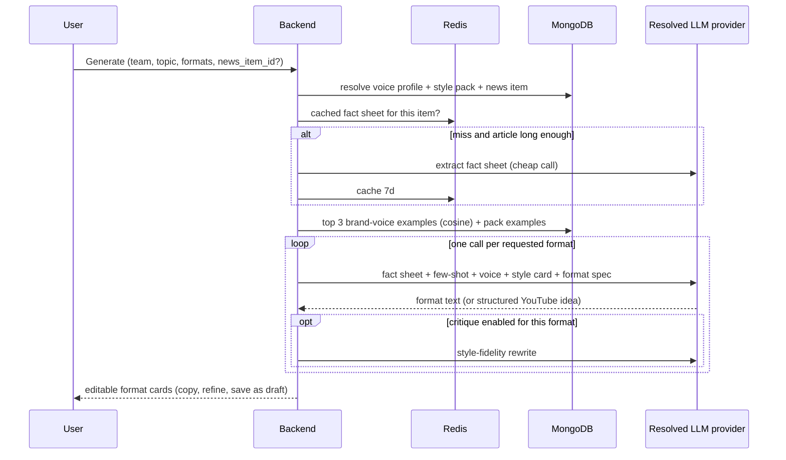

# Growth Studio

> **AI Content & Trend Intelligence Platform** — watches what's trending across seven tech communities, ranks it for your team, and turns any item into publish-ready Facebook / LinkedIn / YouTube content in your own brand voice.

**Team Next Wave** · Built for the *AI Content & Trend Recommendation* hackathon (Jul 12–18, 2026) · **now running in production**

| | |
|---|---|
| **Frontend** | Vercel — `https://growth-studio-sepia.vercel.app` |
| **Backend** | Dokploy (Docker) — `https://growthstudio.nextlevelhq.xyz` |
| **API docs** | `/api/v1/docs` (Swagger UI) · `/api/v1/openapi.json` (OpenAPI 3.1) |
| **Health** | `/health` — reports Mongo + Redis status separately |

---

## Table of Contents

- [The Problem](#the-problem)
- [The Solution](#the-solution)
- [System Architecture](#system-architecture)
- [Subsystems](#subsystems)
  - [1. News ingestion pipeline](#1-news-ingestion-pipeline)
  - [2. Scheduled jobs](#2-scheduled-jobs)
  - [3. LLM provider registry and task resolution](#3-llm-provider-registry-and-task-resolution)
  - [4. Content generation](#4-content-generation)
  - [5. Ask Growth Studio (chat)](#5-ask-growth-studio-chat)
  - [6. Feed serving](#6-feed-serving)
  - [7. Auth, teams, and roles](#7-auth-teams-and-roles)
  - [8. Observability](#8-observability)
- [Retrieval Flows](#retrieval-flows)
- [Data Model](#data-model)
- [API Surface](#api-surface)
- [Tech Stack](#tech-stack)
- [Repository Layout](#repository-layout)
- [Getting Started](#getting-started)
- [Deployment](#deployment)
- [Testing and Verification](#testing-and-verification)
- [How We Work](#how-we-work)
- [Out of Scope](#out-of-scope)
- [Team](#team)

---

## The Problem

A marketing team producing for **Facebook, YouTube, and LinkedIn** at once hits three compounding problems:

1. **No visibility into trends** — hours lost manually browsing HackerNews, Dev.to, GitHub.
2. **Slow, inconsistent creation** — every platform wants a different tone and length.
3. **Generic AI output** — it reads nothing like the team's own writing, especially in Bangla.

## The Solution

| # | Capability | What it does |
|---|-----------|--------------|
| 1 | **Monitor** | Seven adapters pull tech trends continuously; duplicates across communities are merged, not repeated |
| 2 | **Rank** | Decayed trend velocity + brand-voice relevance + LLM audience-fit → one `opportunity_score` per item |
| 3 | **Generate** | One click → FB post, Reel script, LinkedIn post, YouTube idea, caption — grounded in the article's facts and few-shot-conditioned on the team's own posts |
| 4 | **Ask** | Natural-language chat over the team's live trend pool, with conversation history |

---

## System Architecture

A monorepo with two planes: an **unattended background plane** (four cron jobs keeping the trend pool fresh, ranked, and pruned) and an **on-demand serving plane** (REST API behind the dashboard).



**Design principle:** *spend LLM calls only where cheap math can't decide.* Hash dedupe, cosine similarity, and log-scaled trend math gate every LLM call — the judge model only sees the ambiguous middle band of duplicate pairs, and categorization only runs on items that survived everything above it.

---

## Subsystems

### 1. News ingestion pipeline

`backend/src/app/modules/NewsIngestion/` — triggered by cron (`NEWS_INGESTION_CRON`, default every 3h) or manually via `POST /news-items/ingest`. Each layer's per-source counts are persisted to `ingestion_runs`, on success **and** on crash.

| Layer | What it does | LLM cost |
|-------|--------------|:--------:|
| **L1 — Fetch + normalize** | 7 adapters in parallel, each wrapped so one failing source never kills the run; its error is recorded per source | — |
| **L2 — Hash dedupe + freshness** | `content_hash` = SHA-256 of `source:url`, checked against stored items, the deleted-item **tombstone ledger**, and an in-run set; items older than `NEWS_INGESTION_MAX_AGE_HOURS` (72h) are dropped | — |
| **L2b — Two-band semantic dedupe** | Embed survivors, cosine-match against the recent pool. Below `0.88` → accepted. At/above `0.9443` → **hard duplicate**, dropped and its engagement absorbed as *corroboration* on the item it matched. In between → a **gray pair** sent to an LLM judge (`duplicate` / `update` / `distinct`, batched, capped by `NEWS_INGESTION_ADJUDICATION_MAX_BATCHES`). Low-confidence or fallback verdicts keep the item and flag `needs_review` | judge only, on gray pairs |
| **L3 — Relevance + trend scoring** | `relevance_score` = max cosine similarity vs. the pooled brand-voice embeddings of every team (×10) — the platform-wide *baseline*; each team's own score is computed in L5. `trend_score` = `min(10, log10(points + comments×2 + stars_delta×3 + 1) × 3)`. **Neither gates storage** — every deduped fresh item is stored; these are ranking signals | — |
| **L3b — Full-content enrichment** | Link-only items above `NEWS_CONTENT_FETCH_MIN_RELEVANCE` get their article text fetched (`@extractus/article-extractor` + per-source APIs), capped at `NEWS_CONTENT_MAX_CHARS`; status recorded as `none`/`partial`/`full`/`failed` | — |
| **L3c — Metadata backfill** | Cheap `og:` scrape for any item still missing a description or thumbnail | — |
| **L4 — Categorize + opportunity score** | Batched (~10 items/call) LLM assigns `category`, `broad_group`, `impact_note`, `confidence`, `audience_fit` (all persisted, so scores stay recomputable). Then `opportunity_score = 0.4×relevance + 0.3×trend + 0.3×(audience_fit×10)` — computed in code, never picked by the model. Low `confidence` sets `needs_review` | one call per 10 survivors |
| **L5 — Per-team scoring** | For every team with a brand voice: relevance against *that team's own* examples, and an opportunity score derived from it, written to `news_item_team_scores`. This is what the feed and the auto-generation job rank by | — |

**Trend scoring is decay-aware.** Alongside the static `trend_score`, every item carries `current_trend_score` — recomputed at ingest and on every engagement refresh as `base × exp(-age_hours / τ) + bonus × log10(1 + velocity)`, where velocity comes from the last two `engagement_history` snapshots. This is the feed's default sort.

**The taxonomy is open, not fixed.** Six broad groups (`AI`, `Web Dev`, `Career`, `Security`, `DevOps`, `Other`) are permanent, but the categorizer may propose new fine-grained categories, which are recorded in `news_categories` with their parent group. An existing category's group always wins over the model's guess, so groupings can't drift run to run.

### 2. Scheduled jobs

All four run in-process via `node-cron` (`backend/src/app/lib/scheduler.ts`); every callback is try/caught so a failed run can never crash the API. The two maintenance jobs take a Redis lock so overlapping runs are impossible.

| Job | Default schedule | What it does |
|-----|-----------------|--------------|
| **News ingestion** | `0 */3 * * *` | The pipeline above |
| **Engagement refresh** | `30 * * * *` | Re-polls engagement for refreshable sources (hackernews, devto) within a 96h window under a hard request budget, appends an `engagement_history` snapshot, recomputes `current_trend_score` |
| **Retention** | `15 */6 * * *` | Two-stage lifecycle: **archive** (reversible) items past `NEWS_ARCHIVE_MAX_AGE_HOURS`, below `NEWS_ARCHIVE_TREND_FLOOR`, or removed at source — then **hard-delete** after `NEWS_DELETE_AFTER_DAYS`, writing a tombstone so the same URL isn't re-ingested. Recent team overrides and fresh `needs_review` items are protected from archiving |
| **Auto-generation** | `0 6 * * *` (Asia/Dhaka in prod) | Drafts content for each team's top opportunities, up to `AUTO_GENERATION_MAX_PER_RUN`, skipping items already drafted |

### 3. LLM provider registry and task resolution

`backend/src/app/modules/LlmProvider/` + `backend/src/app/lib/modelResolution.ts`.

**Nothing about model choice lives in `.env` anymore.** A super admin registers providers, API keys, and models in the dashboard (*AI Providers*); keys are stored **AES-256-GCM-encrypted** in Mongo (`CREDENTIAL_ENCRYPTION_KEY`) and never returned by read endpoints — list views show `••••1234`.

- **Provider types:** `openrouter`, `anthropic`, `openai` — one adapter each behind a shared `chatCompletion` / `embed` / `embedBatch` contract.
- **Tasks:** `content_generation`, `chat`, `categorization`, `dedup_adjudication`, `style_card`, `critique`, `fact_extraction`, `embedding`.
- **Resolution order per call:** request override → the team's `default_models[task]` → the global super-admin default → a legacy `.env` bootstrap tier. Every tier is validated (model active, capability present, provider active, key active) and **soft-fails through** to the next rather than throwing.
- **Failover:** a provider error re-resolves with the failed key excluded, so the retry lands on a genuinely different key or provider.
- If every tier falls through and no bootstrap key exists, the call raises `LlmNotConfiguredError` instead of silently degrading.

> Embeddings must be **1536-dimension** (`openai/text-embedding-3-small` shape) — enforced by schema validators on `news_items.embedding`, `brand_voice_examples.embedding`, and `style_examples.embedding`.

### 4. Content generation

`backend/src/app/modules/ContentGeneration/` — `POST /content/generate`, `POST /content/refine`.

**Five formats:** `facebook_post`, `facebook_reel_script`, `linkedin_post`, `youtube_idea` (structured JSON: title, hook, chapters, thumbnail concept), `caption`. Each requested format is **its own LLM call**, so per-format length and structure targets are enforceable.

Pipeline per request:

1. **Facts, then write.** For items with enough article text (`CONTENT_FACTS_MIN_CHARS`), a cheap extraction call produces a neutral fact sheet (summary + 5–10 verifiable facts), cached in Redis for 7 days. Writing is grounded in that sheet, not the raw article.
2. **Voice resolution.** Request override → the team's `voice_profile` (language `bangla`/`english` + custom instructions).
3. **Style pack resolution.** Request override → the team's `default_style_pack_id` → none. Soft-fails at every step. A resolved pack contributes its generated **style card** plus up to 5 examples, ranked by similarity with a per-format platform preference.
4. **Brand voice RAG.** Top 3 of the *requesting team's own* `brand_voice_examples` by in-app cosine similarity to the topic embedding. Zero examples is the cold-start signal — retrieval is skipped entirely and a brand-neutral prompt is used, never another team's voice.
5. **Language guard.** Output script is checked against the requested language; a mismatch triggers reinforcement.
6. **Optional critique pass.** A second style-fidelity rewrite, off by default (`CONTENT_CRITIQUE_ENABLED`) — enabling it is an evidence-based call made with the Bangla bake-off harness.

**Generation is never cache-served.** Creative output isn't idempotent, so every requested format always fires a fresh call; `regenerate` is accepted only for older-client compatibility. Only *deterministic* intermediates are cached (fact sheets, topic embeddings — both keyed by the resolved model, both 7-day TTL). Results persist to `generated_content` on explicit save, with a `draft → approved / dismissed` workflow.

### 5. Ask Growth Studio (chat)

`backend/src/app/modules/Chat/` — `POST /chat`, plus `GET /chat/conversations` and `/chat/conversations/:id` for history.

Candidate pool = active items from the last `CHAT_CONTEXT_WINDOW_DAYS` (7), capped at `CHAT_CONTEXT_POOL_CAP` (500), ranked **purely by semantic similarity** to the question with no trend-score pre-filter — a topically perfect item that hasn't accumulated engagement yet is never starved out. Top 5 become grounded context; the last 10 turns of the conversation are replayed. A top similarity below `CHAT_CONTEXT_LOW_RELEVANCE_THRESHOLD` is logged (not gated) so a weak-context answer is distinguishable from a model ignoring good context.

### 6. Feed serving

`GET /news-items` (optional auth — public reads work, authenticated reads personalize).

- **Default sort** `-current_trend_score -created_at`; the UI offers Opportunity / Trending / Newest.
- **Team readiness gating.** A team that hasn't picked subscribed categories *and* added brand-voice examples gets an explicit `team_ready: false` empty state rather than the unfiltered global pool.
- **Subscriptions with group rollup.** Absent an explicit `?category=`, the team's `subscribed_categories` filter applies, matching either the exact `category` **or** the item's `category_group` — so subscribing to "AI" also surfaces a discovered category like "LLM Tooling".
- **Per-team overrides.** `PATCH /news-items/:id/override` recategorizes or re-scores an item **for one team only**, stored in a separate collection so the shared document is never mutated and no other team sees it.
- **Archived items** are excluded unless `?lifecycle=` is passed explicitly.
- **Semantic "nearly relevant" tier** — ready but **off by default** (`NEWS_FEED_SEMANTIC_MATCH_ENABLED`); it uses Atlas `$vectorSearch` to backfill unused room on a page, and needs `news_items_vector_index` confirmed on the cluster first.
- Embeddings are stripped from every response; list responses also drop `content`.

### 7. Auth, teams, and roles

**Two global roles only:** `super_admin` and `user`. (The former middle `admin` tier was removed — team-scoped authority now lives on the membership row instead.)

**Per-team roles:** `team_admin` and `member`, on `team_memberships`. Team settings and member management require `team_admin` of *that* team; a `super_admin` passes every team gate regardless of membership.

- **No public self-registration** — a super admin creates every account (`POST /users`). `SUPER_ADMIN_EMAIL`/`_PASSWORD` seeds the first account on boot if it's missing.
- JWT access token (Bearer) + **httpOnly refresh cookie**; the frontend does single-flight refresh-and-retry on any 401.
- `requireAuth` re-reads role and team membership **from the DB on every request**, so a role change or team removal takes effect immediately instead of at token expiry.
- Token types are non-interchangeable (`token_type` claim), and a password change invalidates every token issued before it.
- Forgot/reset password is public; change-password is authenticated.

### 8. Observability

| Surface | What it gives you |
|---------|-------------------|
| `ingestion_runs` | One document per run — per-source `fetched / fresh_dropped / hash_deduped / semantic_deduped / relevance_dropped / stored`, content-fetch outcomes, adjudication verdict counts, duration, trigger, error. Written even when the run crashes mid-pipeline, so a gap in history always means "didn't run" |
| `maintenance_runs` | Same discipline for engagement-refresh and retention runs (30-day TTL) |
| `activity_log_entries` | Team-scoped audit trail: generation, refine, draft save/approve/dismiss, team settings, membership changes, category corrections |
| `GET /stats/overview` | Team and system rollups for the dashboard |
| `GET /health` | Mongo and Redis reported separately, `503` when either is down |
| `GET /news-items/last-ingested-at` | Cheap poll (id + timestamp, any authenticated user) that the frontend watches to auto-refresh the feed when a run lands |
| pino / pino-http | Structured logs, `/health` excluded from access logging |

---

## Retrieval Flows

Two Atlas Vector Search indexes exist (`news_items.embedding`, `brand_voice_examples.embedding` — 1536-dim, cosine, created by `npm run db:create-indexes`). Most retrieval, however, is deliberately **in-process cosine similarity** over a bounded pool: the pools are small, and it keeps behavior identical whether or not the target cluster has search indexes provisioned.

| Flow | Trigger | Path |
|------|---------|------|
| **Hash dedupe** | Ingestion | `content_hash` vs. stored items + tombstone ledger + in-run set — no embedding |
| **Semantic dedupe** | Ingestion | Batched embeddings → cosine vs. recent pool → two bands → LLM judge on the gray band only |
| **Relevance baseline** | Ingestion | Item embedding vs. the pooled brand-voice embeddings of every team, max similarity — the fallback for anonymous reads and cold-start teams |
| **Per-team relevance** | Ingestion (L5), and on any brand-voice change | Item embedding vs. *one team's* examples → `news_item_team_scores`; ranked in-database so the feed's default `-opportunity_score` sort paginates correctly |
| **Brand voice RAG** | Generate | Topic embedding vs. the *requesting team's own* examples, in-process, top 3 |
| **Style pack RAG** | Generate | Topic embedding vs. the resolved pack's examples, platform-preferred, top 5 |
| **Chat grounding** | Question | Question embedding vs. a 7-day active pool (cap 500), top 5 |
| **Feed semantic tier** | Feed read | The one true `$vectorSearch` path — **off by default** |

Content generation end to end:



---

## Data Model

MongoDB, 19 collections. `✅` marks an Atlas Vector Search index.

**News domain**

| Collection | Purpose | Vector |
|-----------|---------|:---:|
| `news_items` | Ingested + enriched items — engagement, `engagement_history`, `corroborations`, `trend_score`, `current_trend_score`, `category`/`category_group`, `relevance_score`, `opportunity_score`, `category_confidence`, `needs_review`, content + `content_status`, `lifecycle` (`active`/`archived`) + `archive_reason`. Global, not team-scoped | ✅ |
| `news_categories` | Open taxonomy — `name`, `normalized_key`, parent `broad_group`, `source` (`seed`/`ingestion`) | — |
| `news_item_category_overrides` | Per-team `category`/`opportunity_score` override, merged in on read for that team only | — |
| `news_item_team_scores` | Per-team `relevance_score`/`opportunity_score` — one row per (item, team). Relevance is similarity to *that team's* brand voice, so it cannot live on the shared item | — |
| `news_dedup_ledger` | Tombstones for deleted items so the same URL isn't re-ingested; TTL from `NEWS_DEDUP_LEDGER_TTL_DAYS` | — |
| `ingestion_runs` | Per-run, per-source pipeline counts + adjudication stats | — |
| `maintenance_runs` | Engagement-refresh and retention run history (30-day TTL) | — |

**Content domain**

| Collection | Purpose | Vector |
|-----------|---------|:---:|
| `generated_content` | Drafts (`auto`/`manual`), per-format output, `draft`/`approved`/`dismissed`, authorship trail | — |
| `brand_voice_examples` | A team's own real posts, few-shot source — scoped by `team_id` | ✅ |
| `style_packs` | Super-admin-curated writer styles: language, tone tags, generated `style_card` | — |
| `style_examples` | A pack's corpus, with `platform` and an optional topic-summary embedding strategy | — |
| `chat_messages` | Ask Growth Studio history, per team + conversation | — |
| `activity_log_entries` | Team audit trail | — |

**Platform domain**

| Collection | Purpose |
|-----------|---------|
| `users` | Accounts; `role: 'super_admin' \| 'user'`. `password_hash` never selected by default; `password_changed_at` invalidates older tokens |
| `teams` | `custom_categories`, `subscribed_categories`, `voice_profile` (language + instructions), `default_style_pack_id`, `default_models` (per-task LLM overrides) |
| `team_memberships` | Join collection with `role: 'team_admin' \| 'member'`; unique per (team, user) |
| `llm_providers` | Provider type + name + embedded keys (AES-256-GCM ciphertext, `key_last4` for display) |
| `llm_models` | Model catalog per provider, with `capabilities: ['chat' \| 'embedding']` |
| `llm_task_defaults` | One row per task — the global default model |

---

## API Surface

All under `/api/v1`. Envelope: `{ success, message, data, meta? }`.

| Mount | Notable endpoints | Access |
|-------|------------------|--------|
| `/auth` | `login`, `refresh-token`, `logout`, `forgot-password`, `reset-password`, `change-password`, `me` | public / self |
| `/users` | `POST /` (create), `GET /` | super admin |
| `/teams` | CRUD, `:teamId/members` add/remove/role, `:teamId/categories` | mixed: super admin, team admin, member |
| `/news-items` | `GET /`, `GET /:id`, `PATCH\|DELETE /:id/override`, `POST /ingest`, `GET /ingestion-runs`, `GET /maintenance-runs`, `GET /last-ingested-at` | optional auth for reads; super admin for writes and run history |
| `/brand-voice-examples` | CRUD | authenticated |
| `/content` | `POST /generate`, `POST /refine` | team member |
| `/generated-content` | `GET /`, `POST /`, `PATCH /:id` (status), `POST /run` (trigger auto-gen) | team member; `run` is super admin |
| `/chat` | `POST /`, `GET /conversations`, `GET /conversations/:id` | authenticated |
| `/style-packs` | CRUD, examples, `POST /:id/generate-card` | reads authenticated; writes super admin |
| `/llm-providers` | providers, keys, models, `task-defaults`, `models/active` | super admin |
| `/stats` | `GET /overview` | authenticated |
| `/activity-log` | `GET /` | authenticated |

---

## Tech Stack

| Layer | Choice |
|------|--------|
| **Frontend** | Vite 8 · React 19 · TypeScript · Tailwind CSS v4 · React Router v7 · TanStack Query v5 · react-hook-form + Zod · Radix UI primitives · motion · lucide-react · Sonner |
| **Backend** | Node 22 · Express 5 · TypeScript · Mongoose 8 · Zod-validated env and requests · pino · helmet · JWT + bcrypt · node-cron · ioredis |
| **Database** | MongoDB Atlas (Vector Search — Atlas-only; no local mongo image supports it) |
| **Cache / locks** | Redis 7 — job locks, fact-sheet and topic-embedding caches, Product Hunt OAuth token |
| **AI** | Provider-agnostic: OpenRouter, Anthropic, OpenAI — bring your own keys, configured in-app |
| **Testing** | Jest + ts-jest · supertest · mongodb-memory-server · ioredis-mock — 44 suites |
| **Docs** | Hand-built OpenAPI 3.1 document served through Swagger UI |
| **Deploy** | Frontend on Vercel · Backend on Dokploy from `Dockerfile.prod` · Redis in Docker |

---

## Repository Layout

```
AI-Content-Trend-Recommendation/
├─ backend/
│  ├─ src/
│  │  ├─ server.ts                  # boot: Mongo, seeds, taxonomy, 4 schedulers, graceful shutdown
│  │  ├─ app.ts                     # express app, CORS allowlist, /health
│  │  ├─ app/
│  │  │  ├─ config/                 # Zod-validated env (with cross-field refinements)
│  │  │  ├─ routes/                 # 12 module mounts + Swagger UI
│  │  │  ├─ middleware/             # auth (requireAuth / optionalAuth / requireSuperAdmin /
│  │  │  │                          #   requireTeamAccess / requireTeamAdmin), validation, errors
│  │  │  ├─ lib/                    # scheduler, modelResolution, llmClient, embeddings,
│  │  │  │                          #   crypto, redis, logger, seeds, similarity
│  │  │  ├─ builder/QueryBuilder.ts # search / filter / sort / paginate
│  │  │  ├─ docs/                   # OpenAPI 3.1 document, assembled per domain
│  │  │  └─ modules/                # one folder per domain: route/controller/service/
│  │  │     ├─ NewsIngestion/       #   model/interface/validation
│  │  │     │  └─ adapters/         # hackerNews, devto, githubTrending, lobsters,
│  │  │     │                       #   mastodon, producthunt, stackoverflow
│  │  │     ├─ NewsItem/ NewsCategoryTaxonomy/ NewsItemCategoryOverride/
│  │  │     ├─ NewsRefresh/ NewsRetention/ NewsDedupLedger/
│  │  │     ├─ IngestionRun/ MaintenanceRun/ Stats/ ActivityLog/
│  │  │     ├─ ContentGeneration/   # facts, prompt, retrieval, critique, formats, bakeoff
│  │  │     ├─ GeneratedContent/ Chat/ BrandVoiceExample/ StylePack/
│  │  │     └─ LlmProvider/ Team/ User/
│  │  ├─ scripts/                   # db:*, seed:*, verify:*, migrate:*, dev:* CLI entrypoints
│  │  └─ __tests__/                 # 44 unit + integration suites
│  ├─ Dockerfile                    # DEV image (ts-node-dev, source bind-mounted)
│  └─ Dockerfile.prod               # PROD multi-stage image (compiles to dist, runs as node)
├─ frontend/
│  ├─ src/
│  │  ├─ pages/                     # Landing, About, Login, Forgot/ResetPassword
│  │  │  └─ dashboard/              # Overview, Feed, Generate, Drafts, Chat, Activity,
│  │  │     ├─ settings/Team.tsx    #   Guide, Account
│  │  │     └─ admin/               # Pipeline, Users, Teams, Catalog, StylePacks, AIProviders
│  │  ├─ routes/                    # TUserPath[] per tier -> routes + sidebar
│  │  ├─ lib/api/                   # one thin file per backend domain + axios client
│  │  ├─ components/                # landing, feed, generate, team, dashboard, tour,
│  │  │                             #   layout, shared, ui (shadcn-style)
│  │  ├─ context/                   # Auth, Team, Theme, Tour providers
│  │  └─ hooks/                     # useAuthMutations, useNewsIngestionWatcher, ...
│  └─ vercel.json                   # SPA rewrite
├─ openspec/                        # spec-driven change management (66 archived changes)
├─ docker-compose.yml               # Redis + dev backend (Mongo is Atlas, never local)
├─ env.example                      # backend env template
├─ SPEC-DRIVEN-WORKFLOW.md          # how the team ships without conflicts
├─ CLAUDE.md                        # AI assistant / contributor conventions
└─ README.md
```

Frontend routing is **data-driven**: each tier exports a `TUserPath[]` (`name`/`path`/`element`/`icon`/`roles`) that `routeGenerator()` turns into routes — wrapping any `roles`-bearing entry in `<ProtectedRoute>` — and `sidebarItemsGenerator()` turns into the sidebar. Adding a page is one array entry. `super_admin` gets the full set; everyone else (including a team's own `team_admin`) gets the user set, since team-scoped authority is gated in-page, not by route tier.

---

## Getting Started

```bash
# Backend
cd backend && npm install
cp ../env.example .env          # then fill in your own values
npm run dev                     # http://localhost:5000 · docs at /api/v1/docs
npm run typecheck && npm run lint && npm test

# Frontend
cd frontend && npm install
echo "VITE_API_URL=http://localhost:5000/api/v1" > .env
npm run dev                     # http://localhost:5173
npm run build                   # tsc -b && vite build
npm run lint
```

Redis is expected on `localhost:6379` — `docker compose up redis` if you don't have one.

### Backend environment

The env schema (`backend/src/app/config/index.ts`) validates everything at boot and **refuses to start** on a bad value, including cross-field rules (opportunity weights must sum to 1; `HARD_DUP_THRESHOLD > SEMANTIC_DEDUP_THRESHOLD`; `ARCHIVE_MIN_AGE < ARCHIVE_MAX_AGE`).

**Required:**

| Var | Notes |
|-----|-------|
| `DATABASE_URL` | MongoDB **Atlas** connection string — Vector Search is Atlas-only |
| `REDIS_URL` | e.g. `redis://localhost:6379` |
| `JWT_SECRET` | ≥ 16 chars |
| `CREDENTIAL_ENCRYPTION_KEY` | Must decode to exactly 32 bytes — `openssl rand -base64 32` |

**Commonly set:** `PORT` (default `3001` in code, `5000` in Docker/prod), `WEB_URL` (CORS allowlist; `localhost:5173` and `:3000` are always allowed), `LOG_LEVEL`, `JWT_REFRESH_SECRET` (falls back to `JWT_SECRET`), `SUPER_ADMIN_EMAIL` / `_PASSWORD` / `_NAME` (boot seed).

**Optional source credentials** — each only *raises rate limits* or *enables* a source; without them the adapter reports itself unconfigured and the run continues: `GITHUB_TOKEN`, `STACKEXCHANGE_KEY`, `PRODUCTHUNT_CLIENT_ID`/`_SECRET`, `NEWS_INGESTION_MASTODON_INSTANCES`.

**Tuning knobs** (all defaulted — the config file documents the reasoning behind each): ingestion thresholds and cron, content-fetch limits, opportunity weights, trend-decay `τ` and velocity bonus, retention windows, chat context window, and the ready-but-off feature flags (`NEWS_FEED_SEMANTIC_MATCH_ENABLED`, `CONTENT_CRITIQUE_ENABLED`, `STYLE_EXAMPLE_EMBED_BY_TOPIC_SUMMARY`).

> **LLM credentials are not env vars.** Sign in as super admin → **AI Providers** to add providers, keys, models, and per-task defaults. `OPENROUTER_API_KEY` and `LLM_MODEL_*` remain only as a legacy/test bootstrap tier and should be left unset in real deployments.

### Useful backend scripts

```bash
npm run db:create-indexes            # create the two Atlas vector indexes
npm run db:verify-indexes            # confirm they exist on this cluster
npm run seed:admin -- <email> <password> <name> [super_admin]
npm run seed:brand-voice             # seed a team's voice corpus
npm run seed:style-pack              # seed a style pack + examples
npm run seed:news-categories         # seed the six fixed broad groups
npm run style:generate-card          # (re)generate a pack's style card
npm run dev:reset-data               # wipe dev data
npm run dev:clear-news               # clear news_items only
npm run audit:content-coverage       # report on content_status across the pool
npm run backfill:team-scores         # per-team scores for pre-existing items (run once after deploy)
```

---

## Deployment

**Frontend — Vercel.** `vercel.json` rewrites everything to `/index.html` for client-side routing. Set `VITE_API_URL` to the production API base (`https://.../api/v1`).

**Backend — Dokploy, built from `backend/Dockerfile.prod`.** Multi-stage: compile with devDeps, install prod-only deps separately, ship a runtime image with no npm and no source — just `node` and `dist`. It pins `PORT=5000`, sets `TZ=Asia/Dhaka` (all four cron schedules read the container's local time), runs as the `node` user, and uses exec-form `CMD` so `node` is PID 1 and receives `SIGTERM` directly — reaching the graceful-shutdown handler that closes the HTTP server, Mongo, and Redis in order.

> `backend/Dockerfile` is the **dev** image (ts-node-dev, source bind-mounted, never compiles) and is what `docker-compose.yml` uses. Keep both.

**MongoDB** is always Atlas — `docker-compose.yml` deliberately runs no mongo service, because `$vectorSearch` doesn't exist on the community image.

```bash
docker compose up          # Redis + dev backend (reads backend/.env)
```

---

## Testing and Verification

```bash
cd backend
npm test                   # 44 Jest suites: unit + integration
npm run test:watch
```

Integration tests run against `mongodb-memory-server` and `ioredis-mock`, so no live Atlas or Redis is needed; LLM calls are mocked.

Beyond the suite, `src/scripts/verify*.ts` are **live harnesses** — they hit real providers and real data, and exist to answer calibration questions the unit tests can't:

```bash
npm run verify:dedup-calibrate           # calibrate the hard-duplicate threshold
npm run verify:dedup-judge               # inspect gray-band judge verdicts
npm run verify:semantic-dedup-live       # dedup behavior on live ingested data
npm run verify:chat-live                 # end-to-end chat grounding quality
npm run verify:bangla-bakeoff            # per-cell Bangla quality bake-off (--critique both)
npm run verify:engagement-refresh-live
npm run verify:trend-decay-live
npm run verify:dedup-tombstone-live
```

---

## How We Work

Every capability ships through **OpenSpec** (`openspec/`): a change folder carries its proposal, design decisions, delta specs, and task list, and is archived under `openspec/changes/archive/` once implemented. 66 changes are archived to date — those design notes are why so many decisions in this codebase are annotated inline with *why* rather than just *what*.

New here? Read [`SPEC-DRIVEN-WORKFLOW.md`](./SPEC-DRIVEN-WORKFLOW.md) before your first commit, and [`CLAUDE.md`](./CLAUDE.md) for conventions.

---

## Out of Scope

Auto-publishing to platforms · dedicated vector DB (Pinecone/Weaviate) · Slack/Discord notifications · A/B testing · white-labeling.

---

## Team

**Next Wave** — Web Course Level-02

| Name | Role |
|------|------|
| Samin Israr Ravi | Developer |
| Mehedi Imun | Developer |
| Robayat Kalam Farsit | Developer |

> One-liner: *"Growth Studio spots what's trending in tech and turns it into a week of content for Facebook, YouTube, and LinkedIn — in your own brand voice."*
