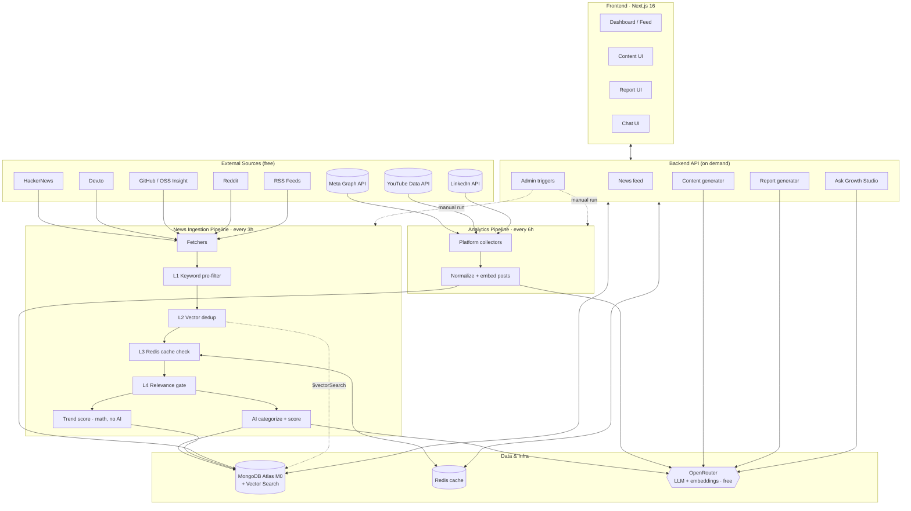
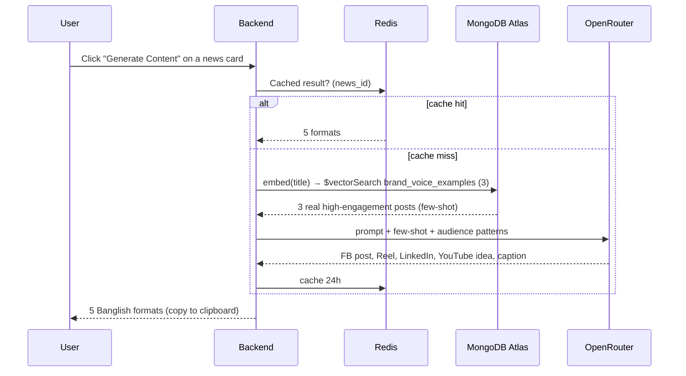

# Growth Studio

> **AI Content & Trend Intelligence Platform** — combines what's trending in tech with what works on *your* channels, and turns it into a full week of content across Facebook, YouTube, and LinkedIn in 5 minutes. Zero AI cost, zero API cost.

**Team Next Wave** · Hackathon topic: *AI Content & Trend Recommendation* · Jul 12–18, 2026

---

## Table of Contents

- [The Problem](#the-problem)
- [The Solution](#the-solution)
- [System Architecture](#system-architecture)
- [Subsystems](#subsystems)
- [Key Data Flows](#key-data-flows)
- [Data Model](#data-model)
- [Tech Stack](#tech-stack)
- [Repository Layout](#repository-layout)
- [Getting Started](#getting-started)
- [Requirements Traceability](#requirements-traceability)
- [Out of Scope](#out-of-scope-phase-2)
- [Team](#team)

---

## The Problem

The Programming Hero marketing team runs content across **Facebook, YouTube, and LinkedIn** at once, and hits four compounding problems:

1. **No visibility into trends** — hours wasted manually browsing HackerNews, Dev.to, Twitter.
2. **No understanding of their own audience** — no single view of what performed and when to post.
3. **Slow, inconsistent content creation** — every platform needs a different tone; they can't keep up.
4. **No link between trends and their data** — a globally trending topic ≠ a topic *their* followers care about.

## The Solution

Growth Studio is a marketing-intelligence platform that does four things:

| # | Capability | What it does |
|---|-----------|--------------|
| 1 | **Monitor** | Pulls tech trends 24/7 from HackerNews, Dev.to, GitHub, Reddit, RSS |
| 2 | **Analyze** | Pulls 30 days of Facebook, YouTube, and LinkedIn performance |
| 3 | **Cross-reference** | Ranks content ideas by *trend score × your audience match* |
| 4 | **Generate** | One click → FB post, Reel script, LinkedIn post, YouTube idea, caption — in Banglish, in your brand voice |

---

## System Architecture

Growth Studio is a **monorepo** with three logical planes: two unattended background pipelines that keep data fresh, and an on-demand serving layer that powers the dashboard.



**Design principle running through everything:** *AI is used only where it adds value.* Cheap string matching, vector dedup, Redis caching, and pure-math scoring gate the expensive LLM calls, keeping cost at **$0** as volume scales.

---

## Subsystems

### 1. News Ingestion Pipeline (every 3h, unattended)
Fetches from 5+ free sources, then runs the **4-layer AI-cost filter** that reduces 200+ raw items to the 20–30 that matter *before any LLM runs*:

| Layer | Check | Cost |
|------|-------|------|
| **L1 — Keyword pre-filter** | Drop items with no PH-relevant keywords | Zero (string match) |
| **L2 — Vector dedup** | 768-dim embedding → `$vectorSearch`; cosine > 0.9 = duplicate | Embedding only |
| **L3 — Redis cache** | `SHA256(title+url)` seen in last 24h → skip | Zero |
| **L4 — Relevance gate** | LLM scores 1–10; < 4 stored but never surfaced | LLM (survivors only) |

Survivors get **AI categorization** (batched 10/call) and a **trend score** computed by pure math:

```
trend_score = normalize(points,500)×4 + normalize(comments,200)×3 + recency_decay×3
recency_decay = max(0, 1 − hoursOld/48)     # 🔥 badge when score ≥ 7
```

### 2. Analytics Pipeline (every 6h, unattended)
Pulls 30 days from **Meta Graph API** (FB), **YouTube Data API v3**, and **LinkedIn API** — reach, engagement, top posts, best times, format breakdown — into `platform_analytics`, and embeds individual posts into `platform_posts` for opportunity scoring.

### 3. Serving / API Layer (on demand)
- **News feed** — filter by category, sort by latest/relevance/trend, "High opportunity" badges
- **Content generator** — lazy (fires on click), 5 formats, Brand Voice RAG, cached 24h
- **Report generator** — unified 30-day cross-platform report with AI insight
- **Ask Growth Studio** — natural-language RAG chat grounded in real data
- **Admin triggers** — manually run ingestion / analytics refresh (demo tooling)

### 4. Frontend (Next.js 16)
daily.dev-style dark dashboard: card feed with tabs, one-click generation, report view, chat.

---

## Key Data Flows

**Four RAG flows over three MongoDB Atlas vector indexes** (`news_items.embedding`, `brand_voice_examples.embedding`, `platform_posts.embedding` — all 768-dim, cosine):

| Flow | Trigger | Path |
|------|---------|------|
| **Semantic dedup** | Ingestion | embed → `$vectorSearch news_items` limit 1 → score > 0.9 = skip |
| **Ask Growth Studio** | User question | embed query → `$vectorSearch news_items` limit 5 → LLM → Banglish answer |
| **Brand Voice RAG** | Generate click | embed topic → `$vectorSearch brand_voice_examples` limit 3 → few-shot into prompt |
| **Opportunity scoring** | Cross-reference | embed trend → `$vectorSearch platform_posts` limit 10 → `opportunity_score = trend_score × avg_engagement_of_similar_posts` |

Content generation end to end:



---

## Data Model

MongoDB collections (see [`project-ida-requirments.md`](./project-ida-requirments.md) §5.8 for full field lists):

| Collection | Purpose | Vector index |
|-----------|---------|:---:|
| `news_items` | Ingested + enriched news (trend/relevance/impact) — global, not team-scoped | ✅ |
| `platform_analytics` | Per-platform 30-day rollups | — |
| `platform_posts` | Individual posts + embeddings for opportunity scoring — scoped per team (`team_id`) | ✅ |
| `generated_content` | Cached multi-format generations | — |
| `brand_voice_examples` | 25–30 real posts seeded as few-shot voice — scoped per team (`team_id`) | ✅ |
| `reports` | Cross-platform 30-day reports | — |

**Auth / multi-team collections** (built 2026-07-14, backend only — see [Out of Scope](#out-of-scope-phase-2)):

| Collection | Purpose |
|-----------|---------|
| `users` | Accounts; `role: 'super_admin' \| 'admin' \| 'user'`. No public self-registration — admins/super_admins create every account (`POST /users`), plus a `SUPER_ADMIN_EMAIL`/`SUPER_ADMIN_PASSWORD`-driven bootstrap on server start |
| `teams` | Growth teams (many-to-many membership with `users` via `team_memberships`) |
| `team_memberships` | Join collection: which users belong to which teams |
| `platform_catalog` | super_admin-curated list of social platforms that exist in the system at all, each with a global enable/disable switch |
| `team_platforms` | Each team's own on/off switch for a catalog platform — must be enabled here (and globally) before the team can add a credential for it |
| `platform_credentials` | Per-team, AES-256-GCM-encrypted social platform tokens (any platform slug, not just Facebook/YouTube/LinkedIn) |

---

## Tech Stack

| Layer | Choice | Notes |
|------|--------|------|
| **Frontend** | Next.js 16 (App Router, Turbopack), TypeScript, Tailwind v4, shadcn/ui | Dark-first, mobile responsive |
| **Backend** | Node.js + TypeScript (in `backend/`) | REST + OpenAPI spec; JWT auth, roles (`user`/`admin`/`super_admin`), multi-team data isolation |
| **Database** | MongoDB Atlas M0 + Atlas Vector Search | 3 vector indexes, free tier |
| **Cache** | Redis | Dedup keys, generation & report caching |
| **AI** | OpenRouter free tier | LLMs + `nomic-embed-text` embeddings |
| **Scheduling** | Cron jobs | Ingestion 3h, analytics 6h |

**AI models (all OpenRouter free tier):** `meta-llama/llama-3.1-8b-instruct:free` (categorization, report, chat), `mistralai/mistral-7b-instruct:free` (content generation), `google/gemma-2-9b-it:free` (fallback), `nomic-ai/nomic-embed-text` (embeddings).

> **Cost targets:** $0 AI + $0 platform API. Feed loads < 1.5s cached, generation < 10s, chat < 6s, report < 15s. See requirements §5 (NFRs).

---

## Repository Layout

```
AI-Content-Trend-Recommendation/
├─ frontend/                    # Next.js 16 app (landing + dashboard)
│  ├─ app/                      # routes (App Router)
│  └─ components/landing/       # landing-page sections
├─ backend/                     # API + ingestion + analytics pipelines (in progress)
├─ openspec/                    # spec-driven change management
│  ├─ changes/<name>/           # one folder per proposed change
│  └─ config.yaml
├─ project-ida-requirments.md   # full product requirements (source of truth)
├─ SPEC-DRIVEN-WORKFLOW.md      # how the 3-dev team works without conflicts
├─ CLAUDE.md                    # AI assistant / contributor conventions
└─ README.md                    # you are here
```

---

## Getting Started

```bash
# Frontend
cd frontend && npm install
npm run dev          # http://localhost:3000
npm run build        # production build
npm run typecheck    # tsc --noEmit
npm run lint         # eslint

# Backend
cd backend && npm install
npm run dev              # http://localhost:3001, docs at /api/v1/docs
npm run typecheck
npm run lint
npm run seed:admin -- <email> <password> <name> [admin|super_admin]   # bootstrap an account manually
```

Required environment (backend `.env` — copy from `.env.example`, all free tiers): `DATABASE_URL`, `REDIS_URL`, `OPENROUTER_API_KEY`, `JWT_SECRET`, `CREDENTIAL_ENCRYPTION_KEY`. Optional: `SUPER_ADMIN_EMAIL`/`SUPER_ADMIN_PASSWORD` (auto-seeds a super_admin on server start if that account doesn't exist yet), plus per-platform bootstrap vars (`FB_PAGE_TOKEN`, `YOUTUBE_API_KEY`, `LINKEDIN_TOKEN`, …) as a fallback for teams that haven't submitted their own credential yet.

> **New to the team?** Read [`SPEC-DRIVEN-WORKFLOW.md`](./SPEC-DRIVEN-WORKFLOW.md) before your first commit — it's how we avoid merge conflicts across 3 developers.

---

## Requirements Traceability

Full functional (FR-01…FR-26) and non-functional (NFR-01…NFR-12) requirements live in [`project-ida-requirments.md`](./project-ida-requirments.md) §5. Each OpenSpec change under `openspec/changes/` maps its specs back to these IDs.

## Out of Scope (Phase 2)

Auto-publishing · dedicated vector DB (Pinecone/Weaviate) · Slack/Discord notifications · A/B testing · paid-ad analytics · white-label.

> **Scope update (2026-07-14):** auth & multi-workspace — originally listed here as Phase 2 — was pulled *into* scope and built on the backend, once it became clear the platform needs to serve several real growth teams, not one. See [Data Model](#data-model) above and `backend/src/app/modules/{User,Team,PlatformCatalog,PlatformCredential}/`. Frontend UI for it (login, admin/super_admin screens, team platform toggles) is still pending — `MEHEDI.md` tracks that.

---

## Team

**Next Wave** — Web Course Level-02

| Name | Role |
|------|------|
| Samin Israr Ravi | Developer |
| Mehedi Imun | Developer |
| Robayat Kalam Farsit | Developer |

> One-liner for judges: *"Growth Studio combines what's trending in tech with what works on YOUR channels — and generates a full week of content across Facebook, YouTube, and LinkedIn in 5 minutes, for free."*
