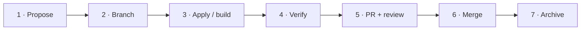
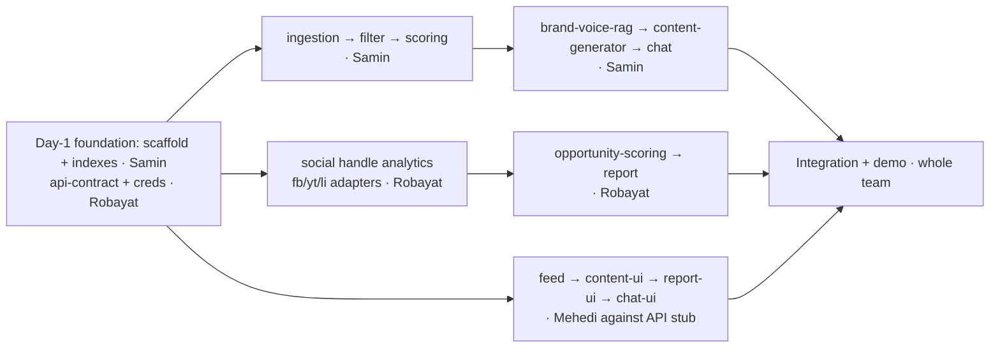

# Spec-Driven Workflow — Working as a Team Without Conflicts

**Team Next Wave** · How 3 developers build Growth Studio in parallel using OpenSpec + Git, with the fewest possible merge conflicts.

> **Read this before your first commit.** Follow the golden rules and you will almost never hit a conflict.

---

## TL;DR — The 5 Golden Rules

1. **One change = one owner = one branch.** Never two people in the same `openspec/changes/<name>/` folder or the same feature branch.
2. **Never commit directly to `main`.** Branch → Pull Request → one teammate reviews → merge.
3. **Own your files.** Split work so two people rarely edit the same file (see the [Ownership Map](#ownership-map)).
4. **Pull before you push, every time.** `git pull --rebase origin main` keeps your branch current and surfaces conflicts early, while they're tiny.
5. **Small PRs, merged daily.** A 200-line PR merged today never conflicts. A 2000-line PR merged Friday always does.

---

## Why Spec-Driven Helps Here

We use **OpenSpec** (`openspec/` folder). Every unit of work is a **change** — a self-contained folder:

```
openspec/changes/<change-name>/
├─ proposal.md   # WHY  — the problem & what changes
├─ design.md     # HOW  — technical decisions
├─ specs/**/     # WHAT — testable requirements (SHALL / scenarios)
└─ tasks.md      # STEPS — the implementation checklist
```

Because each change lives in its **own folder**, two developers proposing two different changes **touch zero shared files** in the planning phase. That's the whole point: spec-driven development *partitions the work for you*. Conflicts only appear when we ignore the golden rules — most often in a handful of shared "aggregator" files (see [Hotspots](#conflict-hotspots)).

---

## The Lifecycle of One Change

Each developer runs this loop independently on their own branch:



### 1. Propose
```bash
/opsx:propose <change-name>      # generates proposal + design + specs + tasks
```
Pick a unique kebab-case name (e.g. `news-ingestion-pipeline`). Check nobody else is using it.

### 2. Branch
```bash
git checkout main
git pull --rebase origin main
git checkout -b feat/<change-name>          # branch name mirrors the change name
```

### 3. Apply (implement)
```bash
/opsx:apply <change-name>        # works through tasks.md, checking off items
```
Commit often, in small logical chunks.

### 4. Verify
```bash
cd frontend && npm run typecheck && npm run lint    # must pass before PR
# (backend: run its tests once scaffolded)
```

### 5. Open a Pull Request
```bash
git push -u origin feat/<change-name>
gh pr create --fill        # or open the PR on GitHub
```
Fill in the checklist (below). Tag one teammate as reviewer.

### 6. Merge
Reviewer approves → **Squash and merge** into `main` → delete the branch. Everyone else then runs `git pull --rebase origin main`.

### 7. Archive
```bash
/opsx:archive <change-name>      # folds delta specs into openspec/specs, closes the change
```

---

## Branching Model

```
main (protected — no direct pushes)
 ├─ feat/news-ingestion-pipeline     (Samin)
 ├─ feat/social-handle-analytics     (Robayat)
 └─ feat/dashboard-feed-ui           (Mehedi)
```

**Branch naming:** `feat/<change-name>`, `fix/<short-desc>`, `chore/<short-desc>` — always matching the OpenSpec change where one exists.

**Commit messages:** short imperative subject, e.g. `feat(ingestion): add 4-layer filter pipeline`. End AI-assisted commits with the co-author trailer if you used Claude.

**Protect `main` (team lead, one-time on GitHub):**
Settings → Branches → Add rule for `main` → *Require a pull request before merging* + *Require 1 approval*. This makes the golden rules impossible to break by accident.

---

## Task Distribution

Every feature in [`project-ida-requirments.md`](./project-ida-requirments.md) is mapped to **one OpenSpec change** with **one owner**. Ownership is split by subsystem folder so two people rarely edit the same file. Each change = one `feat/<change-name>` branch = one PR.

> **How to read this:** the *Change* column is the name you pass to `/opsx:propose <change>`. Build in the order shown (top rows first — they unblock the rest).

### Owner areas (folder boundaries)

| Owner | Subsystem | Owns these paths |
|-------|-----------|------------------|
| **Samin Israr Ravi** | Backend infra + ingestion + AI intelligence + generation (RAG) | `backend/shared/**`, `backend/ingestion/**`, `backend/generation/**`, `backend/rag/**` |
| **Robayat Kalam Farsit** | API contract + platform analytics + reporting + opportunity scoring | `backend/analytics/**`, `backend/reports/**`, `openapi/**` |
| **Mehedi Imun** | Frontend — all UI | `frontend/app/**`, `frontend/components/**` |

> **Shared duties (all three):** rotate PR reviews, and everyone helps with integration + demo-day warm-up. There is no dedicated infra person — the Day-1 foundation below is split across the team.

---

### 🚧 Shared Foundation — Day 1 (do these first)

*Everyone else is blocked until the scaffold + API contract land. Split across the team so it's done in a few hours, in parallel.*

| # | Change | Owner | Key work | Depends on |
|---|--------|-------|----------|:---:|
| 1 | `backend-scaffold` | **Samin** | Node + TS server, Mongo/Redis connections, OpenRouter client, env config | — |
| 2 | `db-vector-indexes` | **Samin** | Create 3 Atlas Vector Search indexes + collection schemas | 1 |
| 3 | `api-contract-openapi` | **Robayat** | Define REST endpoints in OpenAPI + a stub server so FE + BE build in parallel | 1 |
| 4 | `platform-api-credentials` | **Robayat** | Meta / YouTube / LinkedIn app setup, long-lived tokens → `.env` (**start LinkedIn today** — slowest approval) | — |

> Whoever holds page-admin / channel-owner access generates the tokens for #4 and shares them securely; Robayat wires them into config.

### 📡 Samin Israr Ravi — Ingestion & AI Intelligence

| # | Change | FRs | Key work | Depends on |
|---|--------|-----|----------|:---:|
| 1 | `news-ingestion-pipeline` | FR-01 | Fetchers: HackerNews, Dev.to, GitHub/OSS Insight, Reddit, RSS; store raw items; 3h cron | scaffold, indexes |
| 2 | `filter-pipeline` | FR-02, FR-04 | 4 layers: keyword → vector dedup (`$vectorSearch`) → Redis cache → relevance gate | 1 |
| 3 | `ai-categorization-scoring` | FR-03 | Batched LLM categorize + relevance + impact note; **trend_score** math | 2 |
| 4 | `brand-voice-rag` | FR-18 | Seed `brand_voice_examples`, embed, `$vectorSearch` few-shot retrieval | indexes |
| 5 | `content-generator` | FR-13–17, 19–21 | 5 formats (FB post, Reel, LinkedIn, YouTube idea, caption), lazy + Redis 24h | 4 |
| 6 | `ask-growth-studio-chat` | FR-22, FR-23 | RAG chat: embed query → `$vectorSearch news_items` → grounded Banglish answer | 3 |

### 📊 Robayat Kalam Farsit — Analytics & Reporting

| # | Change | FRs | Key work | Depends on |
|---|--------|-----|----------|:---:|
| 1 | `social-handle-analytics` | FR-06 | **Merged 2026-07-14** (was `facebook-analytics`/`youtube-analytics`/`linkedin-analytics` — 3 tasks, now 1, since platforms are no longer hardcoded). One generic job: for every team, for every platform it has enabled, pull last-30-day data via that platform's adapter. 3 adapters built in — Meta Graph API, YouTube Data API v3, LinkedIn API (fallback if approval slow); 6h refresh | scaffold, creds |
| 2 | `opportunity-scoring` | FR-24 | Embed posts → `$vectorSearch platform_posts` → `opportunity_score = trend × audience` | 1, indexes |
| 3 | `cross-platform-report` | FR-09–12 | Unified 30-day report + AI insight + content-opportunity ranking; Redis 6h | 1–2 |

### 🎨 Mehedi Imun — Frontend (Next.js 16)

| # | Change | FRs | Key work | Depends on |
|---|--------|-----|----------|:---:|
| 1 | `news-feed-dashboard` | FR-05, FR-24 | daily.dev-style card feed, tabs, sort, trend 🔥 + "High opportunity" badges | api-contract |
| 2 | `content-generator-ui` | FR-13–17, 21 | Generate button → 5 format panels, copy-to-clipboard | api-contract |
| 3 | `report-ui` | FR-09–11 | 30-day report view: overview, per-platform, AI insight | api-contract |
| 4 | `chat-ui` | FR-22 | Ask Growth Studio chat panel | api-contract |
| 5 | `admin-triggers-ui` | FR-25, FR-26 | Manual "run ingestion" / "refresh analytics" buttons (demo tooling) | api-contract |
| ✅ | `landing-page`, `about-us` | — | *Done* | — |

> **Why FE and BE can both "own" content generation:** they live in different folders (`frontend/components/**` vs `backend/generation/**`), so there's **no file overlap** — they meet only at the API contract. That's the whole trick to parallelizing without conflicts.

---

### Master requirement coverage

| FR range | Feature | Owner |
|----------|---------|-------|
| FR-01, 02, 04 | Ingestion + filter pipeline | Samin |
| FR-03 | AI categorization + scoring | Samin |
| FR-05, 24 | Feed dashboard + opportunity badge (UI) | Mehedi |
| FR-06 (was FR-06/07/08) | Social handle analytics — any team-enabled platform, 3 adapters built in | Robayat |
| FR-09–12 | Cross-platform report | Robayat (BE) + Mehedi (UI) |
| FR-13–17, 19–21 | Content generator | Samin (BE) + Mehedi (UI) |
| FR-18 | Brand Voice RAG | Samin |
| FR-22, 23 | Ask Growth Studio chat | Samin (BE) + Mehedi (UI) |
| FR-25 | Admin trigger — ingestion run | Samin (BE) + Mehedi (UI) |
| FR-26 | Admin trigger — analytics refresh | Robayat (BE) + Mehedi (UI) |
| NFR-08, 09 | $0 AI + $0 API cost | Everyone (design constraint) |

### Build order (dependency graph)



**Parallelism rule:** once the Day-1 foundation lands (`backend-scaffold` + `db-vector-indexes` from Samin, `api-contract-openapi` + `platform-api-credentials` from Robayat), all three tracks run **fully in parallel** — Samin in `backend/ingestion` + `backend/generation`, Robayat in `backend/analytics` + `backend/reports`, Mehedi in `frontend/` against the API stub. No two are ever in the same folder.

---

## Conflict Hotspots

A few files are edited by *every* feature — these cause 90% of real conflicts. Handle them deliberately.

| File | Why it conflicts | Rule |
|------|------------------|------|
| `frontend/app/page.tsx` | Every section adds an import + a render line | Keep edits to **append-only** at the end of the list; merge your PR the same day |
| `frontend/components/landing/Navbar.tsx` (`navLinks`) | Every section adds a nav entry | Append one line to the array; never reorder others' entries |
| `frontend/package.json` / lockfile | Two devs add deps at once | Announce dependency adds in chat; add + commit in a **separate small PR**, merge first |
| `backend/` shared config, DB index defs | Central wiring | Owned by the lead; request changes rather than editing directly |
| `openspec/changes/<name>/` | Two people in one change | **Never share a change folder** — one owner per change |

**Why append-only matters:** Git merges two people *adding different lines at the end of a list* cleanly. It's *editing the same existing line* that conflicts. So when you add a section/nav link/dependency, add a **new** line — don't touch surrounding ones.

**If you do hit a conflict** (usually a both-added list): open the file, keep **both** additions, delete the `<<<<<<<`, `=======`, `>>>>>>>` markers, re-run `npm run typecheck`, then `git add` + continue the rebase. These are the easy conflicts — no logic to untangle.

---

## Daily Rhythm

- **Start of session:** `git checkout main && git pull --rebase origin main`, then rebase your feature branch on top: `git checkout feat/... && git rebase main`.
- **During work:** commit small; push your branch so teammates can see progress.
- **Before a PR:** rebase on latest `main`, run typecheck + lint.
- **End of day:** try to have open PRs merged — don't let a branch live longer than ~a day.
- **Stand-up (async in chat):** each person posts *which change/branch they're on today* so no two people pick overlapping files.

---

## Checklists

**Before opening a PR**
- [ ] Branch is rebased on latest `main`
- [ ] `npm run typecheck` and `npm run lint` pass (frontend); backend tests pass
- [ ] Only touched files inside my ownership area (or flagged shared-file edits in chat)
- [ ] OpenSpec `tasks.md` items checked off; change validates (`openspec validate <name>`)
- [ ] PR description says which FR/NFR IDs it covers

**As a reviewer**
- [ ] Pulled the branch and it runs
- [ ] Changes match the change's `specs/`
- [ ] No unrelated files touched
- [ ] Approve → author squash-merges → delete branch

---

## Quick Reference

```bash
# Start a new change
git checkout main && git pull --rebase origin main
/opsx:propose my-feature
git checkout -b feat/my-feature

# Build it
/opsx:apply my-feature
cd frontend && npm run typecheck && npm run lint

# Ship it
git push -u origin feat/my-feature
gh pr create --fill
# ...review, squash-merge on GitHub...
/opsx:archive my-feature

# Stay current (run often!)
git checkout main && git pull --rebase origin main
git checkout feat/my-feature && git rebase main
```

**The one rule that prevents most pain:** *pull often, merge small, own your files.*
